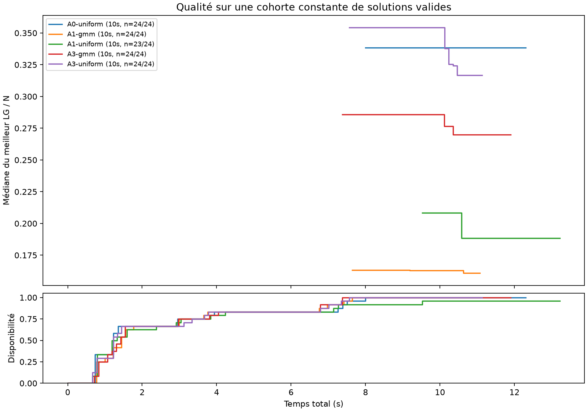
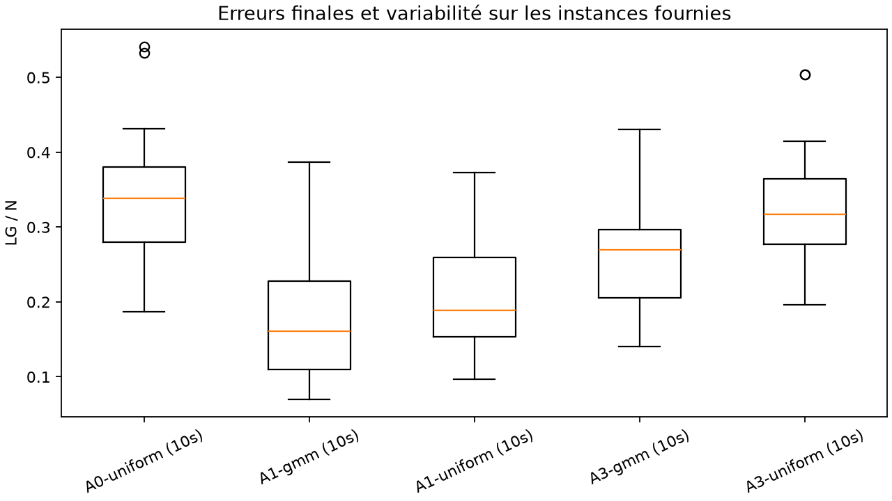

# Jalon 2 : Inv-2-MR-Sort

**Date : 18 octobre 2026.** L'implémentation, l'audit et le pilote sont réalisés. La campagne complète n'a pas été lancée.

## Problème et implémentation

On recherche une partition des observations en deux groupes non vides et un MR-Sort par groupe. L'objectif `LG` compte les observations mal classées par le modèle de leur groupe ; le nombre de catégories est fourni par le problème, indépendamment du nombre de modèles. Les proportions annoncées dans les noms de fichiers ne sont pas imposées.

Le paquet `src/projet` fournit les initialisations uniforme et GMM, A0 (essais indépendants), A1 (transferts faux-vers-vrai), A2-random (exploration des cas ambigus), A3 (recherche locale après réentraînement) et A4 (descentes et perturbations). Les apprentissages à groupes fixés utilisent lincs 2.0.2/WPB, GLOP et un garde-fou comparant chaque candidat à l'ancien modèle sur le nouveau groupe. Les états et snapshots YAML évitent les mutations partagées. Les données et catégories observées restent inchangées.

Le MILP conjoint Gurobi 13.0.3 est distinct : les affectations restent libres, les profils utilisent des positions représentées par des indicateurs monotones sur les valeurs distinctes et les ex æquo sont partagés. Il utilise un seuil de concordance 1, des poids non négatifs bornés à 1 sans normalisation de leur somme et une marge de rejet de `1e-4`, avec tolérances de `1e-8`. La preuve éventuelle concerne cette formulation à marge, pas le problème continu sans marge.

Le [guide d'utilisation](../jalon2.md) décrit les commandes, paramètres, interfaces et limites. Le [rapport d'audit](../audit_jalon2.md) détaille les données.

## Audit et protocole du pilote

Les 72 CSV ont été validés : critères réels croissants sur `[0,1]`, dimensions cohérentes, toutes les catégories représentées, identifiants uniques et aucune valeur manquante, non finie ou hors domaine. Les six problèmes omettent `kind`, ajouté en mémoire uniquement. Aucun modèle source, identifiant de source ou label avant bruit n'est fourni.

Les 36 paires A/B de même nom contiennent exactement les mêmes performances avec des catégories différentes. Elles ne constituent donc pas des échantillons indépendants. Les variantes nominales `noise00`/`noise10` ne sont pas appariées ligne à ligne, et les tailles ne sont pas imbriquées. Le mécanisme du bruit reste inconnu ; B désigne une difficulté annoncée supérieure à A selon l'information utilisateur.

Le pilote comporte les deux fichiers suivants dans chacune des six configurations type/nombre de critères/nombre de catégories :

- `n0300_rep50-50_noise00.csv` ;
- `n1200_rep75-25_noise10.csv`.

Il croise ces douze fichiers avec cinq méthodes et deux graines racines, 0 et 1 : **120 exécutions**. Chaque exécution dispose de dix secondes nominales, avec 0,25 seconde nominale par appel WPB, neuf modèles internes et renouvellement des quatre moins précis. Le GMM utilise deux composantes par catégorie, des covariances diagonales, cinq démarrages et un raccordement par moyenne des centres normalisés. Les expériences sont séquentielles, sur CPU ; les bibliothèques recensées utilisent un thread.

Commande du protocole :

```bash
.venv/bin/projet pilot --config configs/pilot.toml --output results/jalon2/pilot
.venv/bin/projet analyze results/jalon2/pilot
```

Les deux premières exécutions ont été répétées séquentiellement après le pilote pour éliminer leur chevauchement initial avec un essai de validation. Les notes de protocole sont conservées dans `results/jalon2/pilot/protocol_notes.json`.

## Résultats du pilote

**119 exécutions fournissent une solution validée après rechargement ; une se termine sans solution complète.** Aucun résultat invalide numériquement ni exception d'apprentissage n'a été enregistré. Aucune exécution n'atteint zéro erreur.

Les taux ci-dessous sont calculés sur les solutions disponibles. Les fréquences de solution et de zéro tiennent compte de toutes les tentatives. Les quartiles résument la variation entre fichiers et graines, sans constituer un intervalle de confiance.

| Méthode | Solutions / tentatives | Médiane de LG/N | Q1–Q3 | Meilleur LG/N | Temps médian des solutions |
| --- | ---: | ---: | ---: | ---: | ---: |
| A0-uniforme | 24/24 | 33,83 % | 28,00–38,06 % | 18,67 % | 10,40 s |
| A1-uniforme | 23/24 | 18,83 % | 15,33–25,92 % | 9,67 % | 10,32 s |
| A1-GMM | 24/24 | 16,08 % | 11,00–22,79 % | 7,00 % | 10,30 s |
| A3-uniforme | 24/24 | 31,67 % | 27,67–36,48 % | 19,67 % | 10,24 s |
| A3-GMM | 24/24 | 27,00 % | 20,56–29,65 % | 14,00 % | 10,32 s |

Sur les mêmes fichiers et graines disponibles :

- A1-GMM améliore A0-uniforme dans les 24 comparaisons, avec une différence médiane de **−14,88 points** de taux d'erreur.
- A1-GMM améliore A1-uniforme dans **20 des 23** comparaisons ; A1-uniforme est meilleur dans les trois autres. La différence médiane en faveur du GMM est de **2,92 points**.
- A3-GMM améliore A3-uniforme dans **22 des 24** comparaisons ; la différence médiane en faveur du GMM est de **6,46 points**.

Ces observations portent sur ce pilote et ce budget. A1 accepte une médiane de quatre mouvements par exécution valide, contre un pour A3 ; les deux méthodes effectuent environ dix-sept à dix-huit appels WPB. Le coût de l'évaluation des voisins limite donc l'exploration A3 dans ce budget court. Ce résultat n'établit pas un classement général des recherches.

La somme des temps algorithmiques est de **1 253,85 s**, soit environ **20,90 minutes**. La médiane sur les 120 tentatives est de 10,32 s, et le maximum de 13,22 s. L'exécution sans solution est A1-uniforme, graine 1, sur `type_b/cr10_ca05/n1200_rep75-25_noise10.csv` : son premier appel WPB dure environ 10,96 s malgré un arrêt coopératif nominal de 0,25 s, empêchant le démarrage du second apprentissage. Elle reste enregistrée comme `no_solution`, sans erreur fictive égale à zéro et sans remplacement sélectif du résultat.

Les fichiers `summary.csv`, `instance_summary.csv`, `stratified.csv`, `paired_differences.csv`, `failures.csv` et `anytime.csv` se trouvent dans `results/jalon2/pilot/analysis/`. Les figures sont :





Le panneau supérieur utilise une cohorte finale constante et n'apparaît qu'une fois toutes ses solutions disponibles. Le panneau inférieur montre la proportion des tentatives déjà dotées d'une solution ; elle plafonne à 23/24 pour A1-uniforme. `anytime.csv` conserve aussi la médiane partielle et les effectifs à chaque instant.

## Vérifications et limites

**38 tests passent : neuf historiques et vingt-neuf nouveaux.** Le compte rendu brut est dans `results/jalon2/tests.txt`. Ils couvrent notamment la lecture, les égalités, les catégories absentes et groupes singleton, les invariants, le calcul de LG, les mauvais candidats WPB, la borne A1, les cycles A2, les rejets A3, la conservation du meilleur état A4, les budgets, la sérialisation, la reprise après interruption et la stabilité de la cohorte d'agrégation temporelle.

Les tests MILP vérifient des optima connus, la reconstruction sur critères croissants, décroissants et entiers, l'omission d'un démarrage incompatible et la liberté des affectations malgré un point de départ. Le cas CLI `tests/fixtures/cr01_ca03/identical.csv` comporte trois observations identiques portant trois catégories : deux modèles ne peuvent en expliquer que deux sans erreur. Le MILP atteint et prouve l'objectif **1**, avec borne 1 et gap nul. Son résultat est conservé dans `results/jalon2/milp_validation/`.

Les neuf combinaisons principales et le diagnostic à un modèle ont également été exécutés sur un CSV réel en essai court. Ces sorties de validation sont dans `results/jalon2/validation_smoke/` et ne sont pas utilisées pour classer les méthodes. Lors des premiers essais, le MILP déclenchait correctement `license_limit` sur un CSV n0300 avec la licence limitée disponible.

Une licence liée à la machine a ensuite été détectée. Le bac à sable masque son identifiant matériel et provoque `HostID mismatch` ; les derniers tests ont donc été exécutés hors du bac à sable. Dans cet environnement, le MILP a également été exécuté sur `type_a/cr06_ca03/n0300_rep50-50_noise00.csv`, avec trente secondes au total. Il retourne une solution **LG = 56 sur 300**, validée par lincs, à la limite de temps ; ce résultat ne constitue pas une preuve d'optimalité. Les paramètres du solveur, borne, gap et modèles sont conservés dans `results/jalon2/milp_n0300/`.

Le pilote fait varier simultanément taille, bruit et répartition entre ses deux fichiers par configuration ; il ne permet pas d'isoler leurs effets. Les nombres de critères et de catégories varient aussi ensemble. Les répétitions ne mesurent que l'aléa algorithmique sur les fichiers fournis. Aucune évaluation de récupération des sources ou de généralisation hors échantillon n'est possible avec les seules références disponibles.

## Provenance, reprise et suite

L'empreinte du code du pilote est `c5022fa448717596b9106591fe61cf94aa14dc5191f3a3c62c31dab6e4142404`. L'archive `results/jalon2/pilot/source_snapshot.tar.gz` contient exactement ce code, les configurations et dépendances verrouillées. Les 120 résultats ont été repris et leurs identités vérifiées sans relancer WPB ; les 119 états disponibles ont été rechargés et rescorrés. Le journal de reprise est dans `results/jalon2/pilot/resume_check.jsonl`.

Après le pilote, les contrôles finaux ont corrigé la conversion des seuils entiers, l'identité des instances synthétiques, le traitement d'une interruption Gurobi, l'affichage des tentatives sans solution et l'agrégation temporelle dans l'analyse. Les chemins d'apprentissage heuristique sur les CSV réels sont inchangés. Le code courant a donc une nouvelle empreinte et crée volontairement de nouvelles exécutions ; il ne réutilise pas silencieusement les résultats d'une autre version.

Pour contrôler la reprise avec le code exact du pilote depuis la racine du dépôt :

```bash
mkdir -p /tmp/inv2-pilot-replay
tar -xzf results/jalon2/pilot/source_snapshot.tar.gz -C /tmp/inv2-pilot-replay
PYTHONPATH=/tmp/inv2-pilot-replay/src .venv/bin/python -m projet pilot --config /tmp/inv2-pilot-replay/configs/pilot.toml --output results/jalon2/pilot
```

Le budget de campagne proposé reste trente secondes au total et une seconde nominale par appel WPB, dans `configs/campaign.toml`. Ce réglage est un point de départ, pas un optimum de paramétrage démontré ; les dépassements et tentatives sans solution doivent rester suivis. La campagne minimale compte 1 800 exécutions, et les neuf combinaisons A0-A4 en comptent 3 240. Elles nécessitent une commande explicite et n'ont pas été lancées. Les variantes géométriques, exhaustives et de covariance complète restent hors de cette livraison.
