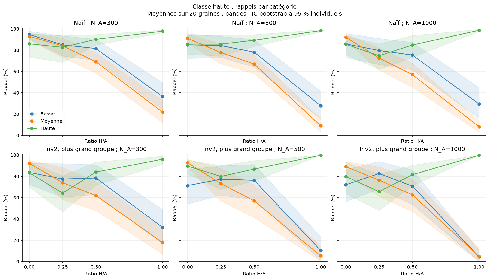
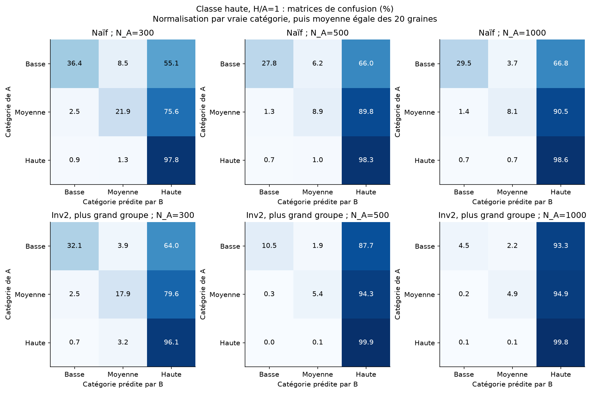
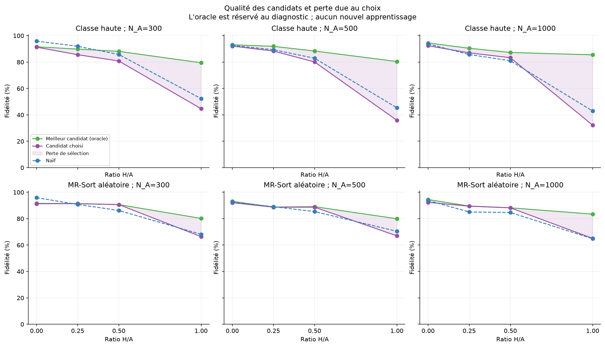
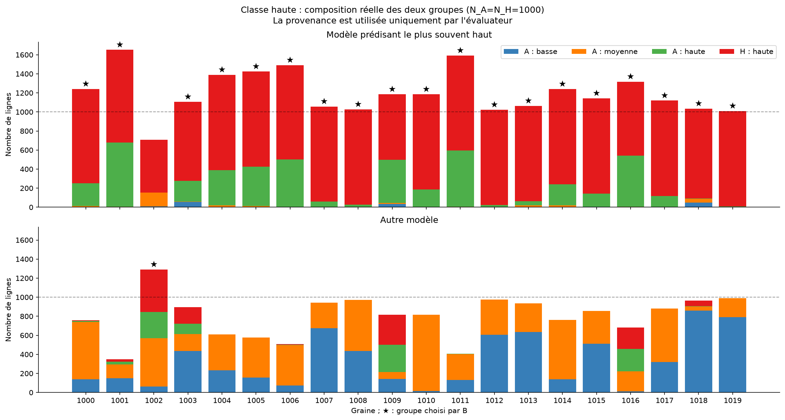
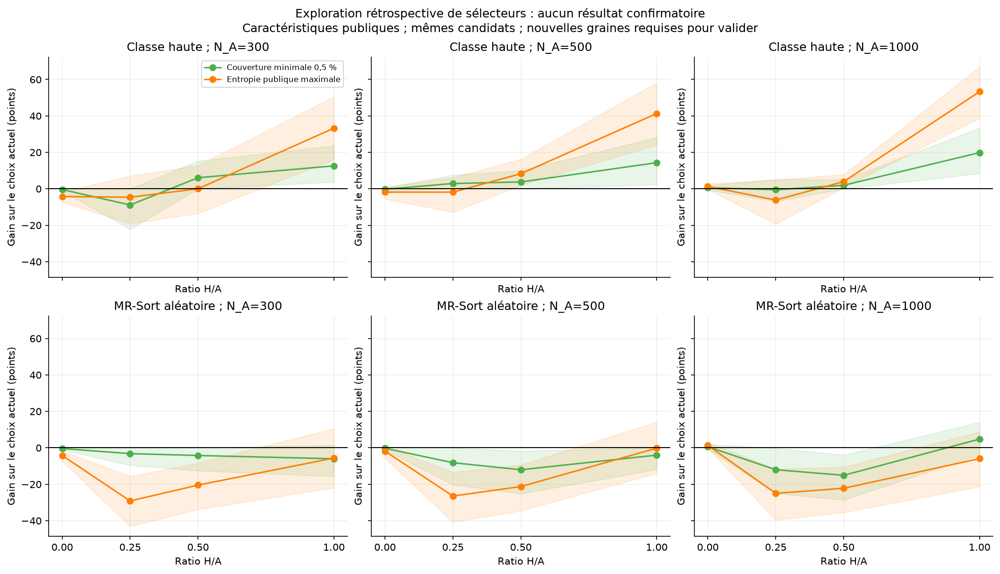
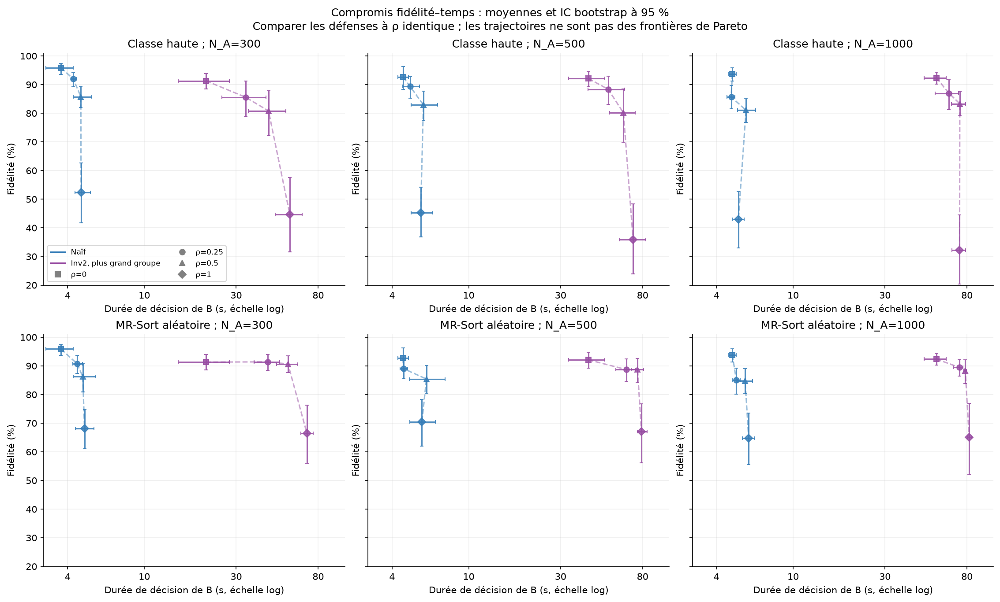
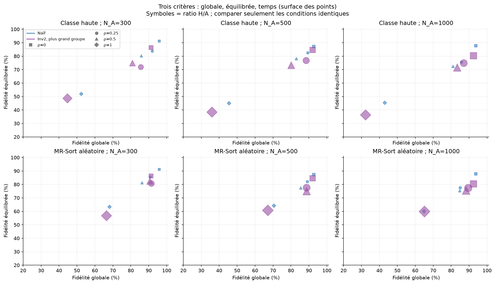

# Analyse approfondie de la confirmation du jalon 3

4 novembre 2026. Source : `../confirmation_quatre_couples_v1`.

Cette analyse recharge les résultats, modèles, tests et partitions déjà calculés.
Elle n'ajoute aucun apprentissage et ne modifie pas la campagne de confirmation.
Les 840 fidélités et rappels ont été recalculés et vérifiés ; 840 candidats Inv2
ont été rechargés pour 420 décisions à deux modèles. Voir [l'audit](audit_analyse.json).

Les diagnostics mécanistiques, les nouveaux graphiques et les deux nouveaux
sélecteurs ci-dessous sont **exploratoires**, après consultation de la confirmation.
Les résultats principaux et leurs IC prévus restent ceux de
[la confirmation](../confirmation_quatre_couples_v1/comparaisons_confirmation.md).

## 1. Quel temps a-t-on mesuré ?

`temps` mesure la durée murale, en secondes, nécessaire à B pour **construire
son modèle final à partir d'un mélange donné**. Ce n'est pas le temps pour
classer une observation, ni le temps pour évaluer les 10 000 objets du test.

| Méthode | Travail inclus dans `temps` |
|---|---|
| Naïf | Construction des objets d'apprentissage LINCS, prétraitement, apprentissage d'un MR-Sort et conversion du modèle |
| Inv2 | Premier apprentissage pour initialiser la partition, apprentissages des deux modèles dans les itérations, réaffectations/évaluation des groupes, puis sélection du modèle du plus grand groupe |

Sont exclus : génération des modèles A/H, génération et mélange des données,
évaluation sur le test, diagnostics privés et écriture des archives. Le coût
de génération de l'attaque n'est donc pas mesuré par cette colonne.

Le chronomètre utilise `time.monotonic()` : c'est une durée écoulée par appel,
pas un temps CPU. Elle dépend aussi de la charge et de l'ordonnancement sur la
machine. La campagne utilisait deux processus de travail ; ces mesures ne sont
pas un benchmark isolé avec ordre d'exécution randomisé.

Pour Inv2 :

    temps = temps_preparation + temps_selection.

La préparation fait l'essentiel du travail ; la sélection compare deux tailles
et récupère le modèle. Les champs `temps_calcul_effectif` évitent de compter
plusieurs fois une préparation lorsqu'elle est partagée entre sélecteurs. Chaque
sélecteur conserve cependant le coût complet dans `temps` pour la comparaison.

L'arrêt nominal LINCS est de 4 secondes par apprentissage, ou avant si un autre
arrêt est déclenché. Inv2 peut faire un apprentissage initial puis deux par
itération, jusqu'à huit itérations : jusqu'à 17 appels. Prétraitements et arrêts
souples expliquent que ce ne soit pas une borne stricte de 68 secondes. Le
paramètre général `temps=12` ne plafonne pas ces deux méthodes officielles.
Les archives ne fournissent pas le nombre exact d'itérations de chaque appel.

Exemples de moyennes sur les vingt graines :

| Condition | N_A | Naïf (s) | Inv2 (s) | Rapport des temps moyens |
|---|---:|---:|---:|---:|
| Sans attaque | 300 | 3,69 | 20,90 | 5,67 |
| Sans attaque | 1000 | 4,84 | 55,42 | 11,46 |
| MR aléatoire, rho=0,5 | 300 | 4,79 | 55,73 | 11,64 |
| MR aléatoire, rho=0,5 | 500 | 6,03 | 75,31 | 12,49 |
| MR aléatoire, rho=0,5 | 1000 | 5,63 | 78,40 | 13,92 |
| Classe haute, rho=1 | 1000 | 5,20 | 73,23 | 14,09 |

Ces résultats comparent les méthodes **telles que configurées**. Ils ne prouvent
pas qu'Inv2 bat un naïf disposant du même temps total. Inversement, un apprentissage
plus long peut être acceptable si le modèle est ensuite réutilisé longtemps.
Les temps de prédiction en exploitation n'ont pas été mesurés séparément.

## 2. Classe haute : les erreurs mesurées

L'attaque pose X_H uniforme et y_H=2 pour toutes les observations. Les
performances sont toujours réparties dans tout le domaine ; seules les étiquettes
sont concentrées. Les catégories sont indicées 0=basse, 1=moyenne, 2=haute.

### 2.1 Elle détruit surtout les rappels bas et moyen

Pour N_A=1000, moyennes sur vingt graines :

| Méthode / condition | Rappel bas | Rappel moyen | Rappel haut | Fidélité globale | Fidélité équilibrée |
|---|---:|---:|---:|---:|---:|
| Naïf, sans attaque | 85,86 % | 92,08 % | 85,52 % | 93,76 % | 87,82 % |
| Naïf, classe haute, rho=0,5 | 75,40 % | 57,05 % | 84,76 % | 81,04 % | 72,40 % |
| Naïf, classe haute, rho=1 | 29,49 % | 8,14 % | 98,60 % | 42,92 % | 45,41 % |
| Inv2, sans attaque | 72,10 % | 89,09 % | 79,89 % | 92,38 % | 80,36 % |
| Inv2, classe haute, rho=0,5 | 70,80 % | 62,70 % | 81,52 % | 83,32 % | 71,68 % |
| Inv2, classe haute, rho=1 | 4,50 % | 4,94 % | 99,80 % | 32,20 % | 36,41 % |

À rho=1, la proportion du test prédite en classe haute atteint 84,68 % pour le
naïf et 96,36 % pour Inv2. Les erreurs vers une catégorie supérieure représentent
56,35 % et 67,70 % de tout le test ; les erreurs vers le bas seulement 0,73 %
et 0,10 %. L'effet est donc très directionnel.

La matrice de confusion moyenne d'Inv2 à N_A=1000, rho=1 est :

| Vraie catégorie A / prédiction B | Basse | Moyenne | Haute |
|---|---:|---:|---:|
| Basse | 4,50 % | 2,20 % | 93,30 % |
| Moyenne | 0,16 % | 4,94 % | 94,90 % |
| Haute | 0,07 % | 0,12 % | 99,80 % |

**Ce n'est pas seulement la classe attaquée qui se dégrade : sa reconnaissance
s'améliore, tandis que les deux autres catégories sont absorbées par elle.**

Pour Inv2, les pertes appariées de rappel depuis son témoin sont :

- Basse : 67,60 points, IC exploratoire à 95 % [48,70 ; 83,65].
- Moyenne : 84,15 points, IC [75,08 ; 91,35].
- Haute : perte de -19,91 points, donc amélioration, IC [-35,74 ; -6,22].





### 2.2 Pourquoi globale et équilibrée diffèrent

Pour une graine s, avec p_c,s la fréquence de la vraie catégorie et R_c,s son rappel :

    F_s = somme_c p_c,s R_c,s ; B_s = (R_0,s + R_1,s + R_2,s) / 3.

Les proportions moyennes des catégories sont 32,89 %, 38,12 %, 28,98 %. Elles
varient fortement entre modèles A : la classe haute va de 0,96 % à 78,48 % du
test. Un modèle presque constant haut peut donc obtenir une fidélité globale
très différente selon la graine, tout en ayant une équilibrée proche de 1/3.

Attention : la moyenne des fidélités est la moyenne des produits p_c,s R_c,s,
pas le produit des fréquences moyennes et des rappels moyens. Leur association
entre graines importe. On ne peut pas expliquer tout l'écart par les seules
fréquences moyennes.

### 2.3 Pourquoi l'apprentissage est attiré vers le haut

Pour des critères croissants, MR-Sort franchit le profil b^k lorsque :

    S_k(x) = somme_j w_j 1{x_j >= b_j^k} >= lambda.

Pour classer un objet haut, il faut franchir les deux profils. Des étiquettes
hautes sur tout le domaine favorisent des règles où ces profils sont plus
faciles à franchir, via les profils, les poids et/ou lambda. Les paramètres
peuvent changer conjointement ; un déplacement uniforme de tous les profils
n'est pas nécessaire.

Un exemple archivé rend cette dégénérescence explicite : graine 1007,
N_A=N_H=1000. Le modèle du groupe choisi a w_1=w_4=0,5, les autres poids nuls,
et lambda=0,5. Pour les deux profils, les seuils sur ces critères actifs valent
environ 0,09986 et 0,00570. Ainsi, il prédit haut dès que :

    x_1 >= 0,09986 OU x_4 >= 0,00570.

Comme les deux profils coïncident sur les critères actifs, il ne prédit jamais
la classe moyenne. Sous l'uniforme indépendant, la région haute couvre environ
1 - 0,09986 * 0,00570 = 99,943 % du domaine. Le diagnostic public de 10 000
points en donne 99,89 %. C'est un modèle presque constant haut.

Cet exemple est choisi après observation pour illustrer un mécanisme ; il
n'est pas une répétition indépendante supplémentaire. Les chiffres sur les
vingt graines encadrent sa portée.

### 2.4 L'effondrement n'est pas une fatalité pour tout ratio

La proportion d'étiquettes hautes dans le mélange vaut, à la population :

    q_2 = (p_2 + rho) / (1+rho).

À rho=1, la classe haute est donc strictement majoritaire dès que p_2>0.
Cette majorité d'étiquettes ne suffit pourtant pas à justifier une règle
constante : les performances contiennent encore de l'information sur A.

À la population, si A et H ont les mêmes performances uniformes :

    P(Y=c | X=x) = [1{M_A(x)=c} + rho 1{c=2}] / (1+rho).

Pour rho<1, la catégorie A reste la plus probable à chaque x. La règle A
elle-même appartient à la famille MR-Sort et minimise le risque de classification
de population. Pour la comparer à la règle constante haute :

    risque_melange(A) = rho (1-p_2) / (1+rho),
    risque_melange(toujours_haut) = (1-p_2) / (1+rho).

À rho=1, ces deux règles ont le même risque attendu sur le mélange, malgré
des fidélités très différentes à A. Le critère d'ajustement sur le mélange
ne favorise donc plus systématiquement A. Pour rho<1, ses échecs impliquent
aussi l'échantillonnage, l'optimisation approximative et/ou la segmentation.

Le hacker MR-Sort aléatoire ne pousse pas toutes les étiquettes dans une même
direction et peut être proche de A. À rho=0,5, Inv2 sélectionne le meilleur de
ses deux candidats pour toutes les vingt graines de N_A=300 et N_A=1000.
À rho=1, sa perte moyenne de sélection passe à 13,80 et 18,37 points ; la
symétrie des deux sources rend alors l'authenticité difficile à identifier.

## 3. Inv2 : apprendre les modèles et choisir A sont deux problèmes

### 3.1 L'oracle et le choix effectif

Pour chaque graine s :

    k_s = argmax_k |G_k,s| ; F_choisie,s = F_A(M_k_s,s),
    O_s = max(F_A(M_0,s), F_A(M_1,s)),
    L_s = O_s - F_choisie,s.

Les moyennes sont calculées ensuite, sur les graines. L'oracle choisit un modèle
entier par graine ; il ne choisit pas séparément pour chaque objet du test.
Il est réservé au diagnostic et ne constitue pas une défense accessible à B.

Pour classe haute à rho=1 :

| N_A | Fidélité choisie | Meilleur candidat, moyenne | Perte de sélection | Graines avec choix strictement moins fidèle |
|---:|---:|---:|---:|---:|
| 300 | 44,69 % | 79,50 % | 34,81 points | 12/20 |
| 500 | 35,89 % | 80,45 % | 44,56 points | 16/20 |
| 1000 | 32,20 % | 85,50 % | 53,30 points | 19/20 |

Pour N_A=1000, le meilleur candidat reste en deçà des 93,76 % du naïf sans
attaque : la sélection n'est donc pas la seule limite. La différence est de
8,26 points en moyenne, alors que l'écart de sélection atteint 53,30 points.
Cette décomposition est descriptive, pas une attribution causale indépendante.



### 3.2 La provenance n'est pas la partition apprise

Toujours : |G_k| = n_A,k + n_H,k. Le groupe le plus grand ne représente donc pas
nécessairement la source la plus nombreuse. Les observations de A déjà hautes
sont compatibles avec la règle du hacker et peuvent rejoindre son groupe.

Une partition cohérente possible avec la règle A et une règle constante haute est :

    |G_haut| = N_H + n_A,haut ; |G_autre| = N_A - n_A,haut.
    |G_haut| > |G_autre| si rho + 2 (n_A,haut / N_A) > 1.

Cette construction peut ne pas respecter la taille minimale imposée à chaque
groupe, ou ne pas être trouvée par l'heuristique. C'est une possibilité expliquant
la faiblesse de la majorité, pas une identité générale des partitions apprises.

Les archives confirment toutefois un regroupement de cette nature. Pour
classe haute, N_A=1000, rho=1, le modèle prédisant le plus souvent haut sur de
nouveaux points publics :

- prédit haut sur 99,03 % de ces points en moyenne ;
- appartient au groupe le plus grand et est choisi dans 19 graines sur 20 ;
- son groupe contient en moyenne 93,71 % des lignes H ;
- il absorbe en moyenne 86,92 % des lignes A de classe haute ;
- il n'absorbe que 3,66 % des lignes A des deux autres classes.

Les trois dernières valeurs sont des moyennes de proportions par graine.
L'orientation « groupe haut » utilise le volume de prédictions hautes sur des
points publics, pas une identité H supposée. Les indices 0 et 1 n'ont pas de
signification A/H fixe.



Exemple graine 1007 :

| Groupe | Taille | Lignes A | Lignes H | Composition des lignes A : basse / moyenne / haute | Fidélité à A |
|---|---:|---:|---:|---|---:|
| Groupe choisi, modèle presque toujours haut | 1057 | 58 | 999 | 1 / 0 / 57 | 6,26 % |
| Autre groupe | 943 | 942 | 1 | 675 / 267 / 0 | 94,49 % |

La formule illustrative donne 1000+57=1057 et 1000-57=943 : exactement les
tailles observées, avec une ligne A basse et une ligne H échangées entre les
groupes. Le classement par taille retient donc le modèle presque constant,
malgré une séparation très nette des deux comportements.

À N_A=1000, rho=0,5, ce groupe haut n'est choisi que dans 4 graines sur 20,
et la perte de sélection moyenne est de 3,96 points. La construction théorique
de majorité est possible pour 9 graines sur 20, mais n'est pas systématiquement
réalisée : la dynamique d'apprentissage et les marges jouent aussi un rôle.

### 3.3 Pourquoi deux autres critères naturels ne suffisent pas

Deux sélecteurs ont été examinés sur les **candidats existants**, en utilisant
10 000 nouveaux points publics uniformes par graine, sans lire A ni son test :

1. Couverture minimale : si un seul candidat attribue au moins 0,5 % des points
   à chaque catégorie, le retenir ; sinon garder le plus grand groupe.
2. Entropie maximale des catégories prédites : retenir le candidat dont les
   prédictions sont les plus diversifiées.

Avec q_k,c la fréquence publique de la catégorie c :

    H_k = - somme_c q_k,c log(q_k,c) / log(3).

Le seuil de 0,5 % fait écho au filtre public des vrais modèles, mais ne garantit
pas que les modèles appris sur des sous-groupes aient eux aussi cette couverture.
Ces règles ont été examinées après constat des échecs : leurs performances ne
constituent pas une nouvelle confirmation et leurs coûts n'ont pas été chronométrés.

Pour N_A=1000 :

| Attaque / ratio | Plus grand groupe | Couverture minimale | Entropie maximale |
|---|---:|---:|---:|
| Classe haute, 0,5 | 83,32 % | 85,25 % | 87,28 % |
| Classe haute, 1 | 32,20 % | 52,05 % | 85,50 % |
| MR aléatoire, 0,5 | 88,22 % | 73,15 % | 66,04 % |
| MR aléatoire, 1 | 65,08 % | 69,87 % | 59,14 % |

L'entropie choisit ici le meilleur candidat pour les vingt graines de classe
haute à N_A=1000, rho=1. Mais face au hacker MR aléatoire à rho=0,5, elle fait
perdre 22,18 points à la même taille. La diversité des catégories n'identifie
donc pas l'authenticité quand les deux sources ont le même prior.

La couverture échoue aussi parfois : le candidat proche de A peut avoir perdu
une catégorie dans son groupe d'apprentissage, tandis que le groupe haut a
absorbé les observations authentiques de cette catégorie. Rejeter ce candidat
parce qu'il est imparfait peut revenir à garder celui du hacker. Des A réellement
déséquilibrés rendent également un critère de diversité délicat.



**Conclusion sur les critères :** il existe un signal exploitable contre cette
attaque particulière, mais aucun des deux critères simples étudiés ne fournit
une amélioration générale. Un futur sélecteur devrait combiner des informations
observables, tenir compte du modèle de menace et être évalué sur des graines
nouvelles. À parts égales et sous le même prior A/H aléatoire, aucun critère
fondé seulement sur le mélange ne peut toujours identifier A.

## 4. Temps, fidélités et dominances

Pour une condition (attaque, N_A, rho) fixée, la défense D1 domine D2 en 2D si
elle demande au plus autant de temps et possède au moins autant de fidélité,
avec au moins une inégalité stricte. En 3D, on exige aussi une fidélité
équilibrée au moins aussi grande. Il s'agit d'espaces de critères de décision,
pas d'une réduction par PCA des six critères des alternatives.

### 4.1 Résultats sur les moyennes

Il y a 21 conditions distinctes : trois tailles, un témoin et six cas sous
attaque par taille. Sur les moyennes, en 2D comme en 3D :

- le naïf domine Inv2 dans 13 conditions ;
- dans 8 conditions, aucune défense ne domine l'autre ;
- Inv2 ne domine le naïf dans aucune condition, car il est toujours plus lent.

Ce décompte décrit la grille choisie : ce n'est ni une estimation de la fréquence
universelle des cas favorables, ni 21 répétitions indépendantes.

Dans les 420 comparaisons appariées des 840 décisions, Inv2 est plus lent dans
419 cas. L'unique exception (témoin N_A=300, graine 1017) est aussi moins fidèle,
globalement et en équilibré ; elle ne constitue donc pas une dominance d'Inv2.
L'absence de dominance d'Inv2 ne signifie donc pas qu'il n'a
aucun avantage en fidélité ; elle signifie qu'il faut payer cet avantage en temps.



### 4.2 Exemples de décisions multicritères

N_A=300, hacker MR aléatoire, rho=0,5 :

- naïf : 4,79 s ; fidélité 86,22 % ; équilibrée 81,21 % ;
- Inv2 : 55,73 s ; fidélité 90,66 % ; équilibrée 82,49 %.

Le gain global de 4,44 points (IC confirmatoire [0,65 ; 9,00]) s'accompagne
d'environ 50,94 secondes supplémentaires, soit 11,6 fois le temps moyen.
Le gain équilibré de 1,27 point a un IC exploratoire [-4,87 ; 7,55] : le
bénéfice sur la fidélité globale ne démontre pas ici un bénéfice équilibré.

N_A=500, même attaque et même ratio : la globale gagne 3,29 points, tandis que
l'équilibrée perd 2,45 points en moyenne ; le temps passe de 6,03 à 75,31 s.
Ce cas montre pourquoi conserver deux critères de qualité peut être informatif.
Les IC des deux différences de qualité incluent zéro ; ne pas en faire des
supériorités/dégradations établies.

N_A=1000, classe haute, rho=1 : le naïf est plus rapide (5,20 s contre 73,23 s),
plus fidèle globalement (42,92 % contre 32,20 %) et en équilibré (45,41 % contre
36,41 %). Il domine Inv2 sur les trois moyennes. Mais cette dominance 3D
individuelle n'apparaît que pour 15 graines sur 20 : les moyennes ne décrivent
pas chaque instance.

### 4.3 Incertitude et présentation

Les comparaisons portent sur les différences par graine, avant moyenne. Les
nouveaux IC utilisent un bootstrap de 10 000 rééchantillonnages, graine 20261104,
individuels et sans correction multiple. De petites différences d'extrémités
avec les anciens IC proviennent du rééchantillonnage ; pour les affirmations
principales, citer les IC du plan confirmatoire existant.

Une dominance sur les moyennes est descriptive. [dominances.csv](dominances.csv)
donne aussi les proportions de graines où chaque défense domine l'autre.
On ne doit pas conclure une dominance statistique simplement parce que deux
moyennes sont ordonnées.

Pour la lecture, une figure 2D fidélité–temps et une vue globale–équilibrée où
la surface représente le temps rendent les trois critères visibles sans les
occlusions d'une perspective 3D. Avec seulement deux défenses par condition,
une perspective 3D n'ajoute pas de front complexe ; le calcul 3D de dominance
est néanmoins effectué explicitement.



On ne mélange pas les différentes attaques, tailles et ratios pour tracer une
frontière globale. Les lignes reliant les ratios sont des trajectoires de
sensibilité, jamais une frontière de Pareto entre méthodes à difficulté égale.

## 5. Ce qui peut être écrit dans le rapport

1. Classe haute fait principalement basculer les catégories basse et moyenne
   vers la haute ; l'effet est directement mesuré dans les confusions.
2. À forte injection, Inv2 apprend souvent un modèle proche de A mais sélectionne
   un groupe plus grand, presque constant haut, réunissant H et des A compatibles.
3. L'efficacité de cette attaque ne vient donc pas d'une incohérence interne
   nécessaire du hacker. Une règle simple et cohérente peut perturber la
   distinction entre taille d'un groupe appris et authenticité.
4. Face au MR aléatoire à ratio intermédiaire, la sélection par taille fonctionne
   beaucoup mieux et peut améliorer la fidélité globale. Le coût de la défense
   sans attaque et son coût de calcul limitent le bénéfice pratique.
5. Les règles de diversité explorées corrigent certains échecs de classe haute
   mais peuvent détériorer fortement le cas MR aléatoire. Une défense adaptée
   à une attaque n'est pas automatiquement robuste aux autres.

Restent hors du périmètre de ces conclusions : optimalité de classe haute,
généralisation à d'autres dimensions/distributions, supériorité à budget égal,
nouveau sélecteur validé et mesures de latence de prédiction en exploitation.
Ces limites n'empêchent pas de répondre au jalon avec les expériences réalisées.

## 6. Reproduction et fichiers

Depuis la racine du projet :

```bash
.venv/bin/python -m jalon3.analyse_approfondie jalon3/results/confirmation_quatre_couples_v1 jalon3/results/une_nouvelle_analyse
```

Pour actualiser uniquement les fichiers générés d'une analyse existante de la
même source, ajouter `--actualiser`. Aucun apprentissage n'est exécuté.

- [Décisions et confusions recalculées](decisions_detaillees.csv)
- [Composition, paramètres et qualité des candidats](groupes.csv)
- [Diagnostics des paires par graine](paires_candidats.csv)
- [Résumés des métriques et IC](resume_metriques.csv)
- [Résumés des diagnostics des candidats](resume_candidats.csv)
- [Contrastes appariés exploratoires](contrastes_apparies.csv)
- [Dominances 2D et 3D](dominances.csv)
- [Choix des sélecteurs exploratoires](selecteurs_exploratoires.csv)
- [Résumé des sélecteurs](resume_selecteurs.csv)
- [Audit et empreintes](audit_analyse.json)

Les neuf figures sont disponibles en PNG et SVG dans `figures/`.
