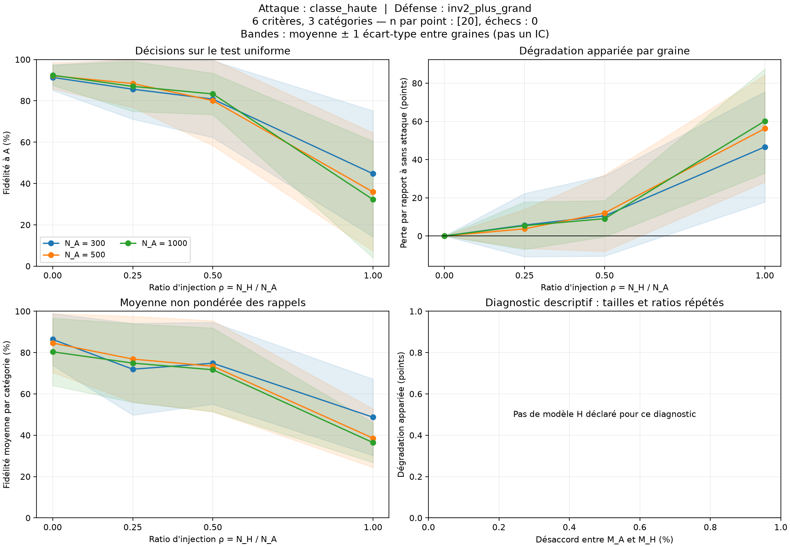
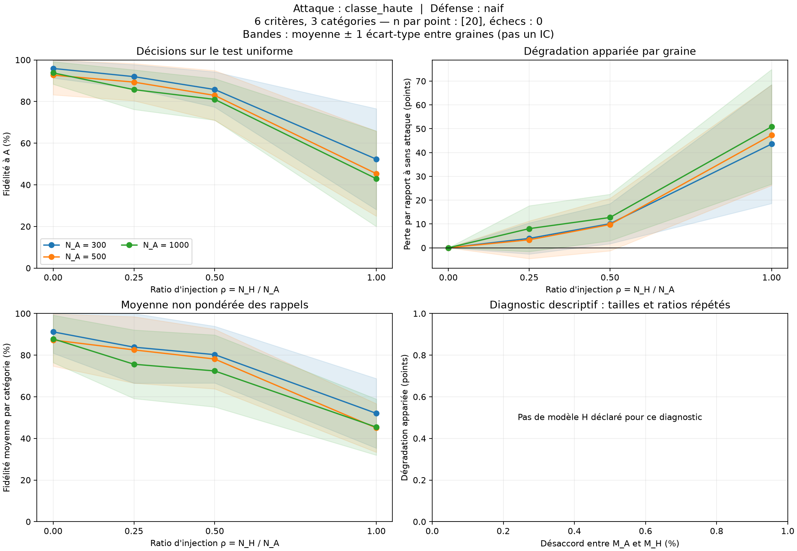
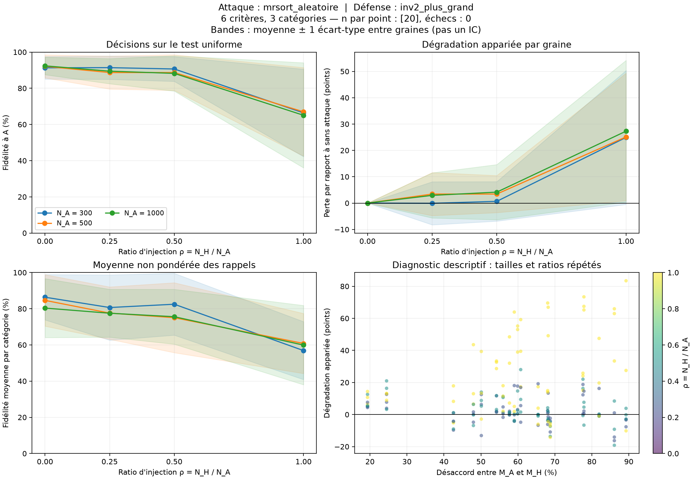
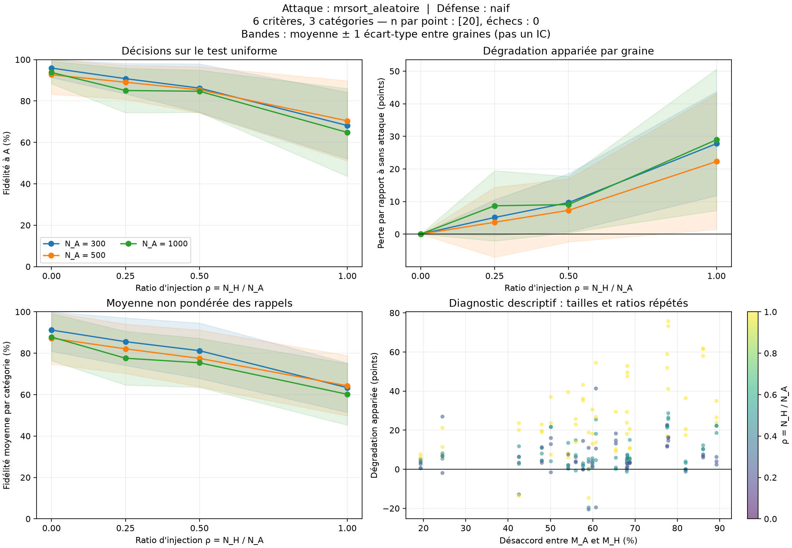
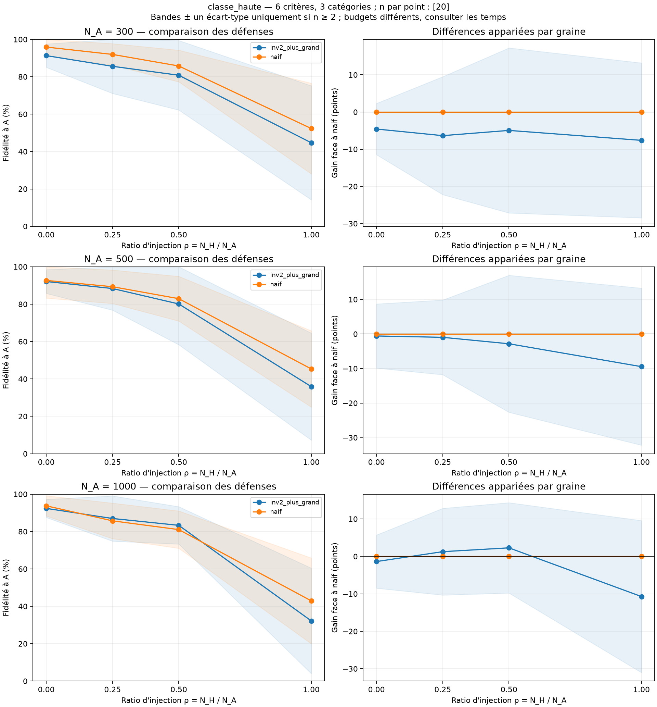
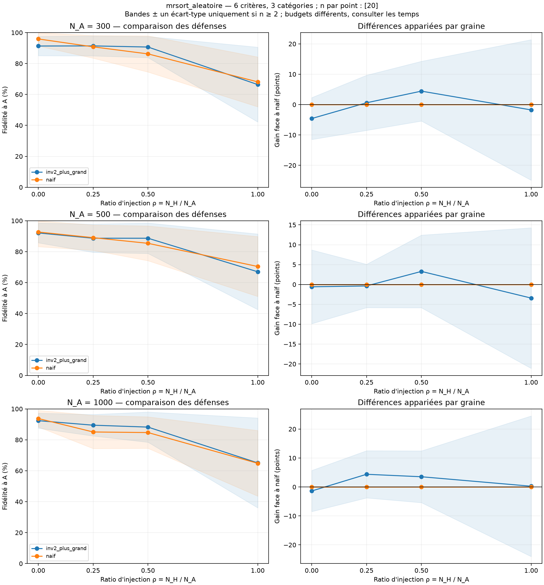

> Campagne complète : 60/60 lots audités, 840/840 évaluations. Les artefacts sont dans `lots/`.

# Bilan de la campagne

840 parties ; 840 réussies ; 0 en erreur.

Les graines sont les répétitions indépendantes. Les tailles et ratios d'une même graine sont appariés.
Les dispersions sont des écarts-types entre graines ; elles ne sont pas des intervalles de confiance.

| Taille A | Ratio H/A | Attaque | Défense | n / échecs | Fidélité (%) | Écart-type (points) | Perte appariée (points) | Fidélité équilibrée (%) |
|---:|---:|---|---|---:|---:|---:|---:|---:|
| 300 | 0 | aucun | inv2_plus_grand | 20 / 0 | 91.32 | 6.25 | 0.00 | 86.37 |
| 300 | 0 | aucun | naif | 20 / 0 | 95.90 | 4.58 | 0.00 | 91.18 |
| 300 | 0.25 | classe_haute | inv2_plus_grand | 20 / 0 | 85.61 | 14.52 | 5.71 | 71.95 |
| 300 | 0.25 | classe_haute | naif | 20 / 0 | 91.96 | 5.78 | 3.93 | 83.83 |
| 300 | 0.25 | mrsort_aleatoire | inv2_plus_grand | 20 / 0 | 91.40 | 6.44 | -0.08 | 80.66 |
| 300 | 0.25 | mrsort_aleatoire | naif | 20 / 0 | 90.79 | 7.32 | 5.10 | 85.57 |
| 300 | 0.5 | classe_haute | inv2_plus_grand | 20 / 0 | 80.83 | 18.61 | 10.49 | 74.83 |
| 300 | 0.5 | classe_haute | naif | 20 / 0 | 85.78 | 8.47 | 10.12 | 80.24 |
| 300 | 0.5 | mrsort_aleatoire | inv2_plus_grand | 20 / 0 | 90.66 | 6.84 | 0.65 | 82.49 |
| 300 | 0.5 | mrsort_aleatoire | naif | 20 / 0 | 86.22 | 11.72 | 9.67 | 81.21 |
| 300 | 1 | classe_haute | inv2_plus_grand | 20 / 0 | 44.69 | 30.50 | 46.63 | 48.70 |
| 300 | 1 | classe_haute | naif | 20 / 0 | 52.31 | 24.26 | 43.58 | 52.02 |
| 300 | 1 | mrsort_aleatoire | inv2_plus_grand | 20 / 0 | 66.39 | 24.18 | 24.92 | 56.87 |
| 300 | 1 | mrsort_aleatoire | naif | 20 / 0 | 68.14 | 16.11 | 27.76 | 63.34 |
| 500 | 0 | aucun | inv2_plus_grand | 20 / 0 | 92.12 | 6.36 | 0.00 | 84.62 |
| 500 | 0 | aucun | naif | 20 / 0 | 92.70 | 9.45 | 0.00 | 87.26 |
| 500 | 0.25 | classe_haute | inv2_plus_grand | 20 / 0 | 88.37 | 11.56 | 3.75 | 76.84 |
| 500 | 0.25 | classe_haute | naif | 20 / 0 | 89.33 | 8.95 | 3.36 | 82.52 |
| 500 | 0.25 | mrsort_aleatoire | inv2_plus_grand | 20 / 0 | 88.69 | 9.13 | 3.42 | 77.59 |
| 500 | 0.25 | mrsort_aleatoire | naif | 20 / 0 | 89.06 | 8.20 | 3.64 | 82.11 |
| 500 | 0.5 | classe_haute | inv2_plus_grand | 20 / 0 | 80.10 | 21.79 | 12.01 | 73.39 |
| 500 | 0.5 | classe_haute | naif | 20 / 0 | 82.94 | 11.96 | 9.76 | 78.12 |
| 500 | 0.5 | mrsort_aleatoire | inv2_plus_grand | 20 / 0 | 88.69 | 9.87 | 3.43 | 75.05 |
| 500 | 0.5 | mrsort_aleatoire | naif | 20 / 0 | 85.40 | 11.25 | 7.30 | 77.50 |
| 500 | 1 | classe_haute | inv2_plus_grand | 20 / 0 | 35.89 | 28.62 | 56.23 | 38.57 |
| 500 | 1 | classe_haute | naif | 20 / 0 | 45.35 | 20.41 | 47.35 | 45.01 |
| 500 | 1 | mrsort_aleatoire | inv2_plus_grand | 20 / 0 | 67.00 | 24.46 | 25.12 | 60.81 |
| 500 | 1 | mrsort_aleatoire | naif | 20 / 0 | 70.42 | 19.36 | 22.28 | 64.27 |
| 1000 | 0 | aucun | inv2_plus_grand | 20 / 0 | 92.38 | 4.85 | 0.00 | 80.36 |
| 1000 | 0 | aucun | naif | 20 / 0 | 93.76 | 5.42 | 0.00 | 87.82 |
| 1000 | 0.25 | classe_haute | inv2_plus_grand | 20 / 0 | 86.98 | 12.12 | 5.40 | 74.90 |
| 1000 | 0.25 | classe_haute | naif | 20 / 0 | 85.72 | 9.51 | 8.04 | 75.63 |
| 1000 | 0.25 | mrsort_aleatoire | inv2_plus_grand | 20 / 0 | 89.45 | 6.95 | 2.93 | 77.52 |
| 1000 | 0.25 | mrsort_aleatoire | naif | 20 / 0 | 85.07 | 10.71 | 8.69 | 77.58 |
| 1000 | 0.5 | classe_haute | inv2_plus_grand | 20 / 0 | 83.32 | 10.00 | 9.06 | 71.68 |
| 1000 | 0.5 | classe_haute | naif | 20 / 0 | 81.04 | 9.99 | 12.72 | 72.40 |
| 1000 | 0.5 | mrsort_aleatoire | inv2_plus_grand | 20 / 0 | 88.22 | 9.78 | 4.16 | 75.59 |
| 1000 | 0.5 | mrsort_aleatoire | naif | 20 / 0 | 84.69 | 10.18 | 9.07 | 75.37 |
| 1000 | 1 | classe_haute | inv2_plus_grand | 20 / 0 | 32.20 | 28.24 | 60.18 | 36.41 |
| 1000 | 1 | classe_haute | naif | 20 / 0 | 42.92 | 22.96 | 50.84 | 45.41 |
| 1000 | 1 | mrsort_aleatoire | inv2_plus_grand | 20 / 0 | 65.08 | 29.05 | 27.31 | 59.91 |
| 1000 | 1 | mrsort_aleatoire | naif | 20 / 0 | 64.81 | 21.23 | 28.95 | 60.14 |

## Figures

## Limites d'interprétation

- Sans défense (`naif`), un seul modèle est appris : aucune mesure de séparation des deux règles.
- À parts égales, le rôle A/H est indiscernable sous les lois symétriques du protocole.
- Le désaccord est un diagnostic du simulateur, caché à A, H et B. Il ne sélectionne pas les modèles.
- Le filtre des catégories rares est estimé sur 2 000 points distincts ; il conditionne la population étudiée.
- Les rappels par catégorie peuvent être imprécis pour les classes rares. La fidélité équilibrée est vide si une classe manque au test.
- L'apprentissage naïf utilise l'arrêt du jalon 2 (seuil de temps interne nominal de 4 s, ou arrêt anticipé). Ce seuil ne plafonne pas strictement la durée totale observée. Les données sont reproductibles ; les modèles appris peuvent varier avec la charge machine.
- Une augmentation de la perte avec le ratio n'est pas imposée. Une perte négative signifie une amélioration sur cette répétition.
- Le nuage désaccord/perte répète les mêmes modèles pour plusieurs tailles et ratios : il ne représente pas autant de répétitions indépendantes.

## Calcul, sélection et diagnostics

Le temps attribuable à une défense inclut toute sa préparation. Lorsque deux sélections partagent Inv-2, le temps de préparation est inclus dans chacune ; le calcul réellement exécuté n'est compté qu'une fois dans `temps_calcul_effectif`.

Le gain face à naif est calculé sur le même mélange et la même graine. Il ne prouve pas un avantage à budget égal : naif et Inv-2 gardent leurs arrêts propres. `naif_multi` est un contrôle de redémarrages, à budget demandé explicite.

Les fidélités oracle et reconstructions à permutation près utilisent les vérités cachées uniquement après la décision de B. Elles ne servent jamais à choisir son groupe. La perte de sélection sépare l'absence d'un bon candidat d'un mauvais choix parmi les candidats.

| Critères × catégories | Taille A | Ratio H/A | Attaque | Défense | Temps attribuable moyen (s) | Gain face à naif (points) | Perte de sélection (points) |
|---|---:|---:|---|---|---:|---:|---:|
| 6 × 3 | 300 | 0 | aucun | inv2_plus_grand | 20.902 | -4.58 | 0.27 |
| 6 × 3 | 300 | 0 | aucun | naif | 3.688 | 0.00 | — |
| 6 × 3 | 300 | 0.25 | classe_haute | inv2_plus_grand | 33.533 | -6.35 | 4.26 |
| 6 × 3 | 300 | 0.25 | classe_haute | naif | 4.277 | 0.00 | — |
| 6 × 3 | 300 | 0.25 | mrsort_aleatoire | inv2_plus_grand | 43.791 | 0.61 | 0.00 |
| 6 × 3 | 300 | 0.25 | mrsort_aleatoire | naif | 4.472 | 0.00 | — |
| 6 × 3 | 300 | 0.5 | classe_haute | inv2_plus_grand | 44.168 | -4.95 | 7.29 |
| 6 × 3 | 300 | 0.5 | classe_haute | naif | 4.681 | 0.00 | — |
| 6 × 3 | 300 | 0.5 | mrsort_aleatoire | inv2_plus_grand | 55.729 | 4.44 | 0.00 |
| 6 × 3 | 300 | 0.5 | mrsort_aleatoire | naif | 4.789 | 0.00 | — |
| 6 × 3 | 300 | 1 | classe_haute | inv2_plus_grand | 56.978 | -7.62 | 34.81 |
| 6 × 3 | 300 | 1 | classe_haute | naif | 4.695 | 0.00 | — |
| 6 × 3 | 300 | 1 | mrsort_aleatoire | inv2_plus_grand | 69.971 | -1.75 | 13.80 |
| 6 × 3 | 300 | 1 | mrsort_aleatoire | naif | 4.892 | 0.00 | — |
| 6 × 3 | 500 | 0 | aucun | inv2_plus_grand | 41.835 | -0.58 | 1.00 |
| 6 × 3 | 500 | 0 | aucun | naif | 4.555 | 0.00 | — |
| 6 × 3 | 500 | 0.25 | classe_haute | inv2_plus_grand | 53.024 | -0.97 | 3.57 |
| 6 × 3 | 500 | 0.25 | classe_haute | naif | 4.962 | 0.00 | — |
| 6 × 3 | 500 | 0.25 | mrsort_aleatoire | inv2_plus_grand | 65.996 | -0.37 | 0.10 |
| 6 × 3 | 500 | 0.25 | mrsort_aleatoire | naif | 4.585 | 0.00 | — |
| 6 × 3 | 500 | 0.5 | classe_haute | inv2_plus_grand | 63.644 | -2.83 | 8.29 |
| 6 × 3 | 500 | 0.5 | classe_haute | naif | 5.816 | 0.00 | — |
| 6 × 3 | 500 | 0.5 | mrsort_aleatoire | inv2_plus_grand | 75.314 | 3.29 | 0.40 |
| 6 × 3 | 500 | 0.5 | mrsort_aleatoire | naif | 6.032 | 0.00 | — |
| 6 × 3 | 500 | 1 | classe_haute | inv2_plus_grand | 71.404 | -9.46 | 44.56 |
| 6 × 3 | 500 | 1 | classe_haute | naif | 5.630 | 0.00 | — |
| 6 × 3 | 500 | 1 | mrsort_aleatoire | inv2_plus_grand | 78.917 | -3.42 | 12.95 |
| 6 × 3 | 500 | 1 | mrsort_aleatoire | naif | 5.714 | 0.00 | — |
| 6 × 3 | 1000 | 0 | aucun | inv2_plus_grand | 55.418 | -1.38 | 2.12 |
| 6 × 3 | 1000 | 0 | aucun | naif | 4.837 | 0.00 | — |
| 6 × 3 | 1000 | 0.25 | classe_haute | inv2_plus_grand | 64.533 | 1.26 | 3.49 |
| 6 × 3 | 1000 | 0.25 | classe_haute | naif | 4.768 | 0.00 | — |
| 6 × 3 | 1000 | 0.25 | mrsort_aleatoire | inv2_plus_grand | 73.190 | 4.38 | 0.12 |
| 6 × 3 | 1000 | 0.25 | mrsort_aleatoire | naif | 5.071 | 0.00 | — |
| 6 × 3 | 1000 | 0.5 | classe_haute | inv2_plus_grand | 73.428 | 2.28 | 3.96 |
| 6 × 3 | 1000 | 0.5 | classe_haute | naif | 5.695 | 0.00 | — |
| 6 × 3 | 1000 | 0.5 | mrsort_aleatoire | inv2_plus_grand | 78.402 | 3.53 | 0.00 |
| 6 × 3 | 1000 | 0.5 | mrsort_aleatoire | naif | 5.633 | 0.00 | — |
| 6 × 3 | 1000 | 1 | classe_haute | inv2_plus_grand | 73.225 | -10.72 | 53.30 |
| 6 × 3 | 1000 | 1 | classe_haute | naif | 5.199 | 0.00 | — |
| 6 × 3 | 1000 | 1 | mrsort_aleatoire | inv2_plus_grand | 82.121 | 0.26 | 18.37 |
| 6 × 3 | 1000 | 1 | mrsort_aleatoire | naif | 5.879 | 0.00 | — |
