# Bilan de la campagne

21 parties ; 21 réussies ; 0 en erreur.

Les graines sont les répétitions indépendantes. Les tailles et ratios d'une même graine sont appariés.
Les dispersions sont des écarts-types entre graines ; elles ne sont pas des intervalles de confiance.

| Taille A | Ratio H/A | Attaque | Défense | n / échecs | Fidélité (%) | Écart-type (points) | Perte appariée (points) | Fidélité équilibrée (%) |
|---:|---:|---|---|---:|---:|---:|---:|---:|
| 100 | 0 | aucun | filtrage_iteratif | 1 / 0 | 73.70 | — | 0.00 | 55.64 |
| 100 | 0 | aucun | naif | 1 / 0 | 76.89 | — | 0.00 | 62.28 |
| 100 | 0 | aucun | naif_multi | 1 / 0 | 76.89 | — | 0.00 | 62.28 |
| 100 | 0.5 | classe_basse | filtrage_iteratif | 1 / 0 | 43.50 | — | 30.20 | 51.90 |
| 100 | 0.5 | classe_basse | naif | 1 / 0 | 38.33 | — | 38.56 | 51.13 |
| 100 | 0.5 | classe_basse | naif_multi | 1 / 0 | 46.54 | — | 30.35 | 53.08 |
| 100 | 0.5 | classe_haute | filtrage_iteratif | 1 / 0 | 78.88 | — | -5.18 | 69.74 |
| 100 | 0.5 | classe_haute | naif | 1 / 0 | 81.65 | — | -4.76 | 77.01 |
| 100 | 0.5 | classe_haute | naif_multi | 1 / 0 | 81.65 | — | -4.76 | 77.01 |
| 100 | 0.5 | mrsort_concentre | filtrage_iteratif | 1 / 0 | 66.28 | — | 7.42 | 64.08 |
| 100 | 0.5 | mrsort_concentre | naif | 1 / 0 | 44.54 | — | 32.35 | 55.21 |
| 100 | 0.5 | mrsort_concentre | naif_multi | 1 / 0 | 74.08 | — | 2.81 | 61.36 |
| 100 | 1 | classe_basse | filtrage_iteratif | 1 / 0 | 23.07 | — | 50.63 | 40.98 |
| 100 | 1 | classe_basse | naif | 1 / 0 | 22.67 | — | 54.22 | 41.96 |
| 100 | 1 | classe_basse | naif_multi | 1 / 0 | 12.71 | — | 64.18 | 36.45 |
| 100 | 1 | classe_haute | filtrage_iteratif | 1 / 0 | 65.84 | — | 7.86 | 46.52 |
| 100 | 1 | classe_haute | naif | 1 / 0 | 65.68 | — | 11.21 | 47.98 |
| 100 | 1 | classe_haute | naif_multi | 1 / 0 | 65.68 | — | 11.21 | 47.98 |
| 100 | 1 | mrsort_concentre | filtrage_iteratif | 1 / 0 | 54.67 | — | 19.03 | 53.85 |
| 100 | 1 | mrsort_concentre | naif | 1 / 0 | 63.51 | — | 13.38 | 59.43 |
| 100 | 1 | mrsort_concentre | naif_multi | 1 / 0 | 69.10 | — | 7.79 | 60.83 |

## Figures

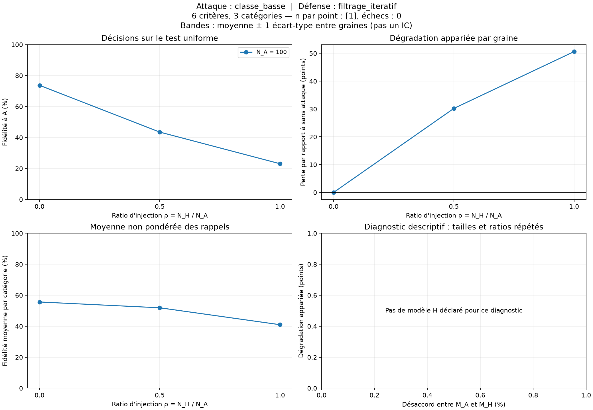
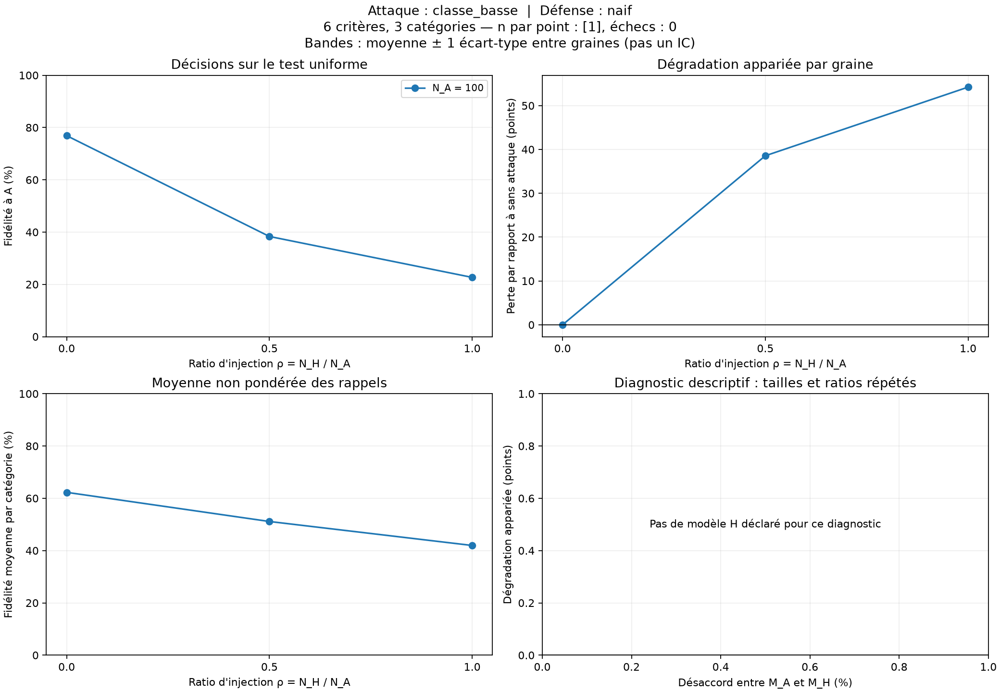
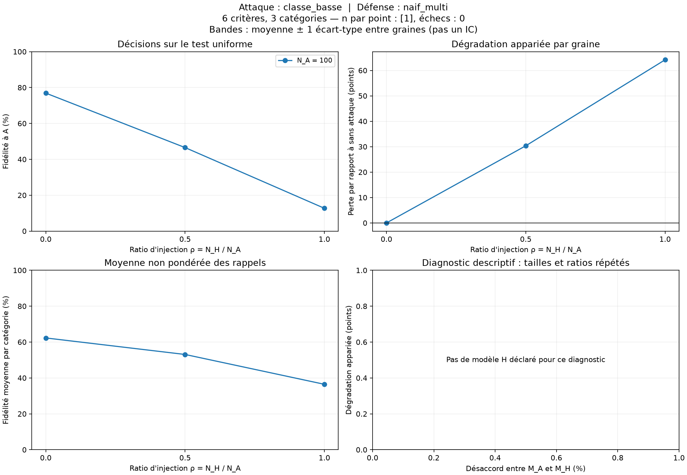
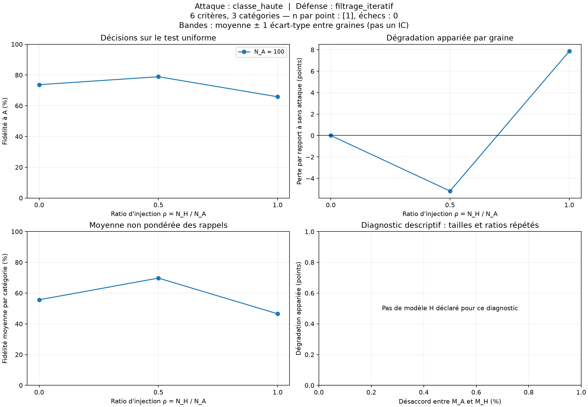
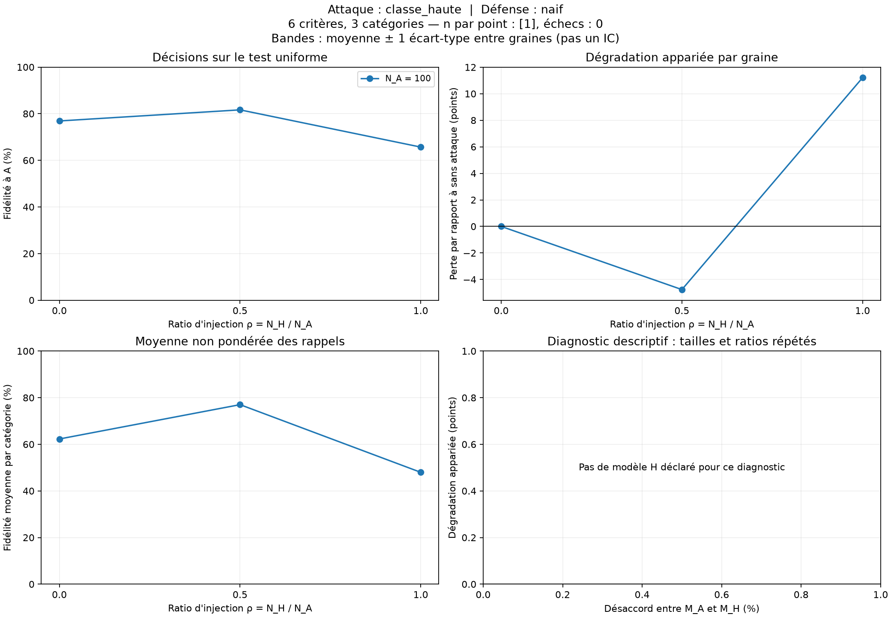
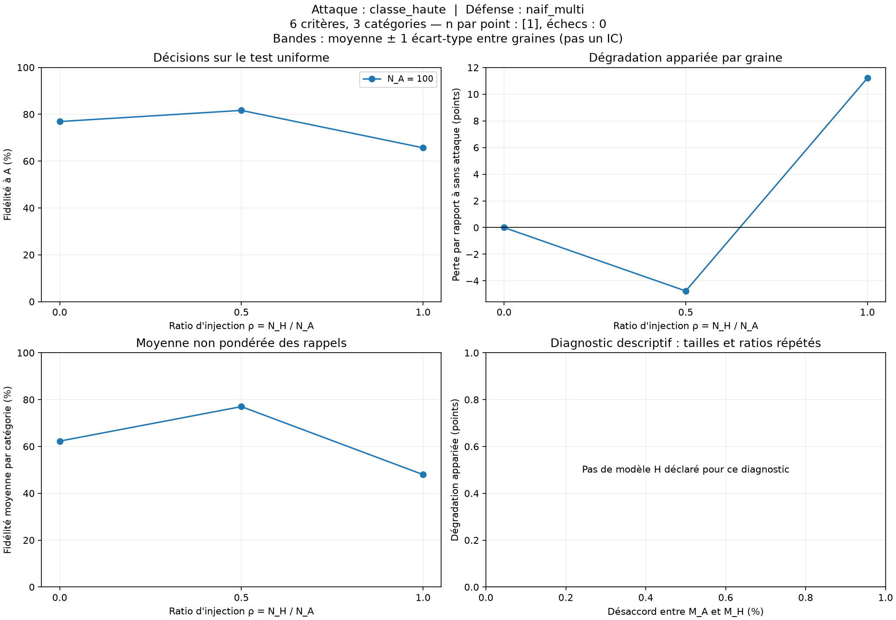
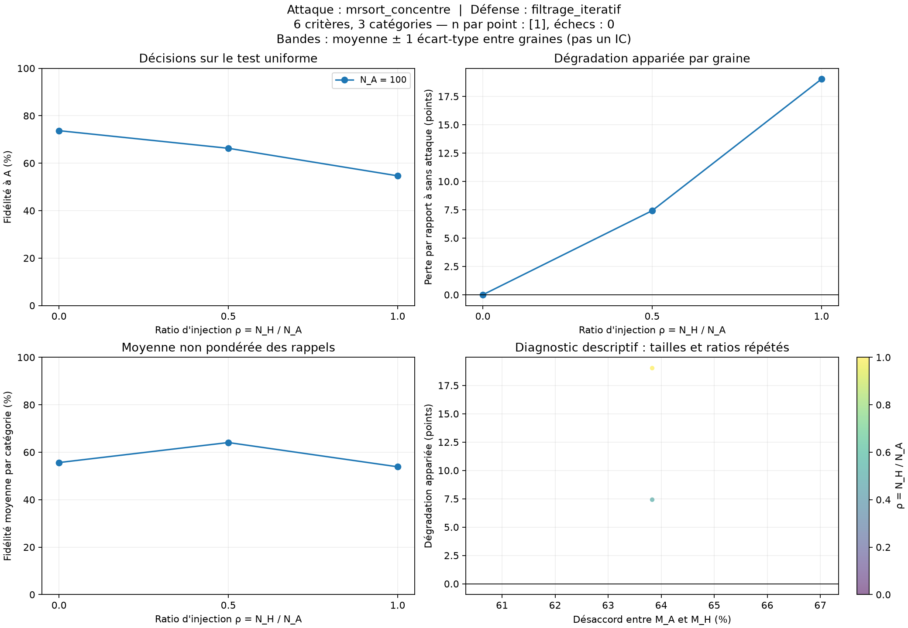
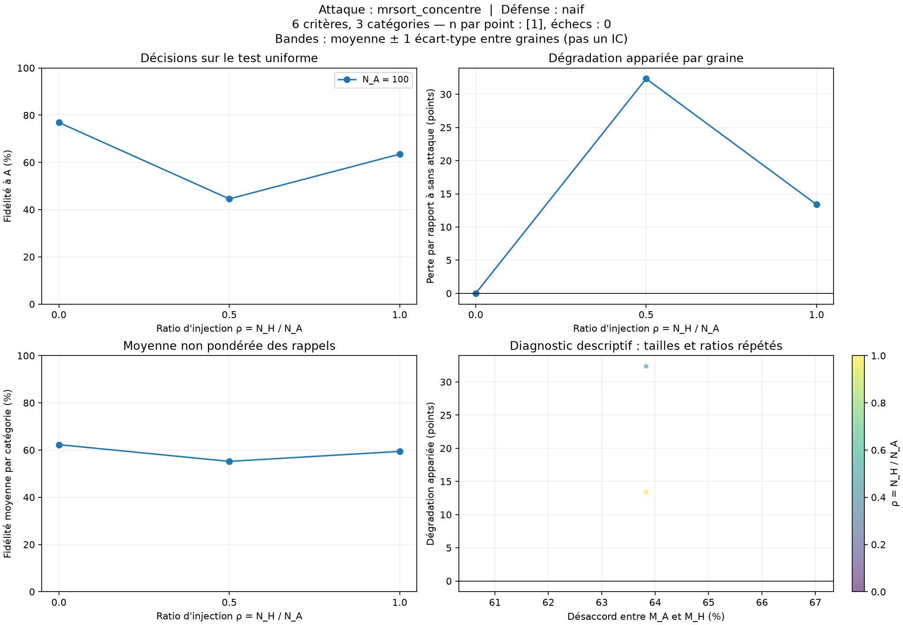
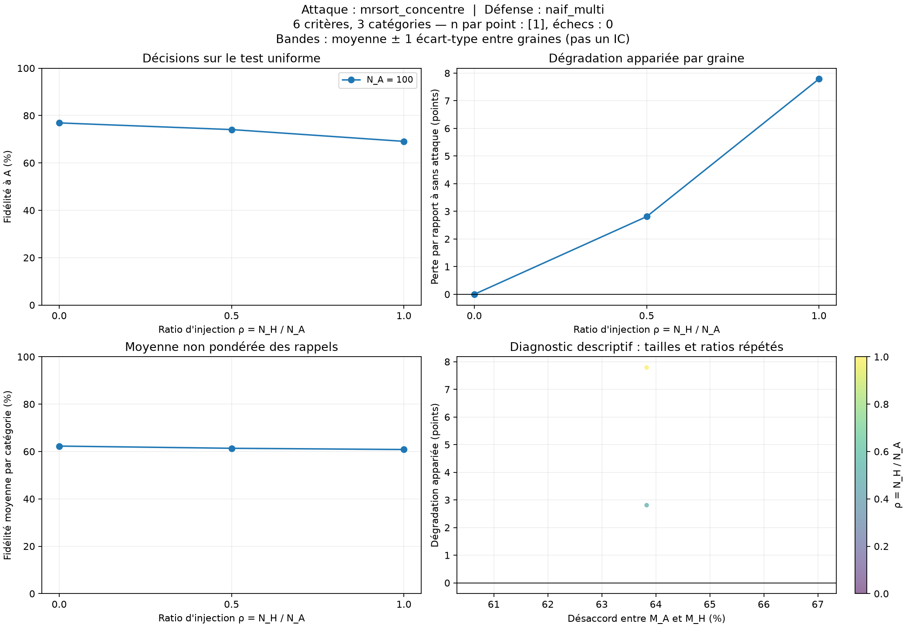
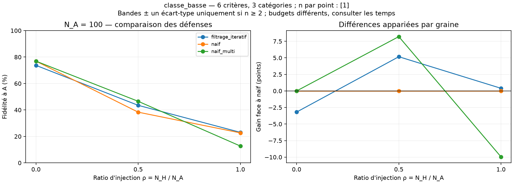
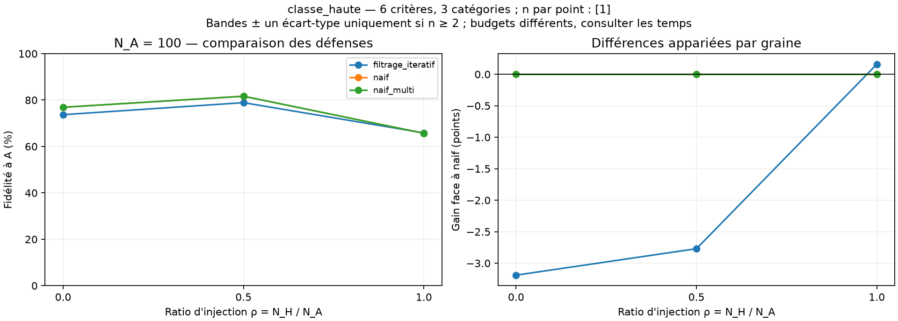
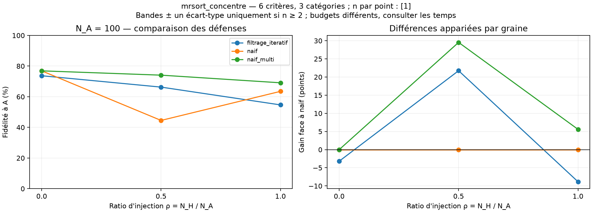

## Limites d'interprétation

- Sans défense (`naif`), un seul modèle est appris : aucune mesure de séparation des deux règles.
- À parts égales, le rôle A/H est indiscernable sous les lois symétriques du protocole.
- Le désaccord est un diagnostic du simulateur, caché à A, H et B. Il ne sélectionne pas les modèles.
- Le filtre des catégories rares est estimé sur 2 000 points distincts ; il conditionne la population étudiée.
- Les rappels par catégorie peuvent être imprécis pour les classes rares. La fidélité équilibrée est vide si une classe manque au test.
- L'apprentissage naïf utilise l'arrêt du jalon 2 (seuil de temps interne nominal de 4 s, ou arrêt anticipé). Ce seuil ne plafonne pas strictement la durée totale observée. Les données sont reproductibles ; les modèles appris peuvent varier avec la charge machine.
- Une augmentation de la perte avec le ratio n'est pas imposée. Une perte négative signifie une amélioration sur cette répétition.
- Le nuage désaccord/perte répète les mêmes modèles pour plusieurs tailles et ratios : il ne représente pas autant de répétitions indépendantes.

## Calcul, sélection et diagnostics

Le temps attribuable à une défense inclut toute sa préparation. Lorsque deux sélections partagent Inv-2, le temps de préparation est inclus dans chacune ; le calcul réellement exécuté n'est compté qu'une fois dans `temps_calcul_effectif`.

Le gain face à naif est calculé sur le même mélange et la même graine. Il ne prouve pas un avantage à budget égal : naif et Inv-2 gardent leurs arrêts propres. `naif_multi` est un contrôle de redémarrages, à budget demandé explicite.

Les fidélités oracle et reconstructions à permutation près utilisent les vérités cachées uniquement après la décision de B. Elles ne servent jamais à choisir son groupe. La perte de sélection sépare l'absence d'un bon candidat d'un mauvais choix parmi les candidats.

| Critères × catégories | Taille A | Ratio H/A | Attaque | Défense | Temps attribuable moyen (s) | Gain face à naif (points) | Perte de sélection (points) |
|---|---:|---:|---|---|---:|---:|---:|
| 6 × 3 | 100 | 0 | aucun | filtrage_iteratif | 10.025 | -3.19 | — |
| 6 × 3 | 100 | 0 | aucun | naif | 4.237 | 0.00 | — |
| 6 × 3 | 100 | 0 | aucun | naif_multi | 9.173 | 0.00 | — |
| 6 × 3 | 100 | 0.5 | classe_basse | filtrage_iteratif | 8.537 | 5.17 | — |
| 6 × 3 | 100 | 0.5 | classe_basse | naif | 4.035 | 0.00 | — |
| 6 × 3 | 100 | 0.5 | classe_basse | naif_multi | 8.473 | 8.21 | — |
| 6 × 3 | 100 | 0.5 | classe_haute | filtrage_iteratif | 8.282 | -2.77 | — |
| 6 × 3 | 100 | 0.5 | classe_haute | naif | 4.095 | 0.00 | — |
| 6 × 3 | 100 | 0.5 | classe_haute | naif_multi | 8.218 | 0.00 | — |
| 6 × 3 | 100 | 0.5 | mrsort_concentre | filtrage_iteratif | 8.197 | 21.74 | — |
| 6 × 3 | 100 | 0.5 | mrsort_concentre | naif | 4.098 | 0.00 | — |
| 6 × 3 | 100 | 0.5 | mrsort_concentre | naif_multi | 8.096 | 29.54 | — |
| 6 × 3 | 100 | 1 | classe_basse | filtrage_iteratif | 8.291 | 0.40 | — |
| 6 × 3 | 100 | 1 | classe_basse | naif | 4.123 | 0.00 | — |
| 6 × 3 | 100 | 1 | classe_basse | naif_multi | 8.196 | -9.96 | — |
| 6 × 3 | 100 | 1 | classe_haute | filtrage_iteratif | 8.553 | 0.16 | — |
| 6 × 3 | 100 | 1 | classe_haute | naif | 4.304 | 0.00 | — |
| 6 × 3 | 100 | 1 | classe_haute | naif_multi | 8.387 | 0.00 | — |
| 6 × 3 | 100 | 1 | mrsort_concentre | filtrage_iteratif | 8.274 | -8.84 | — |
| 6 × 3 | 100 | 1 | mrsort_concentre | naif | 4.084 | 0.00 | — |
| 6 × 3 | 100 | 1 | mrsort_concentre | naif_multi | 8.550 | 5.59 | — |
