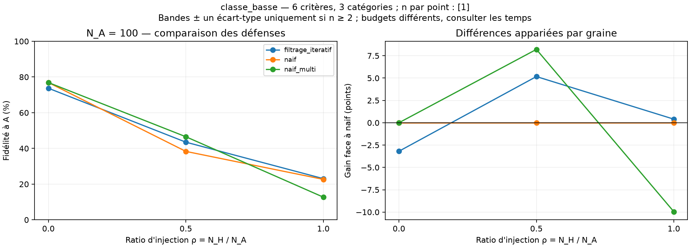

# Essai fonctionnel des nouvelles stratégies

**21 décisions réussies, sans échec**, sur une seule graine (0), 100 observations A, ratios 0 / 0,5 / 1 et 10 000 objets de test. Ce sont des observations sur une instance, pas une estimation statistique de robustesse.

Attaques : `classe_basse`, `classe_haute`, `mrsort_concentre`. Défenses : `naif`, `naif_multi`, `filtrage_iteratif`. Les paramètres sont fixés dans le [protocole](../../docs/comparaisons.md). Les nouvelles méthodes utilisent un budget souple demandé de 12 s et ont ici réalisé deux apprentissages par condition. Les temps réels et les nombres d’appels sont archivés.

| Attaque | Ratio H/A | Naïf (%) | Naïf multi (%) | Filtrage (%) |
|---|---:|---:|---:|---:|
| aucun | 0 | 76,89 | 76,89 | 73,70 |
| classe_basse | 0.5 | 38,33 | 46,54 | 43,50 |
| classe_basse | 1 | 22,67 | 12,71 | 23,07 |
| classe_haute | 0.5 | 81,65 | 81,65 | 78,88 |
| classe_haute | 1 | 65,68 | 65,68 | 65,84 |
| mrsort_concentre | 0.5 | 44,54 | 74,08 | 66,28 |
| mrsort_concentre | 1 | 63,51 | 69,10 | 54,67 |

Le filtrage retire 16 % des lignes authentiques dans le contrôle sans attaque et obtient une fidélité de 73,70 %, contre 76,89 % pour le naïf. Ce résultat montre qu’un filtrage fondé sur les erreurs du modèle peut écarter des données correctes ; il ne doit pas être présenté comme une protection garantie. Les modèles initiaux sont réappris avec la même graine mais ne sont pas partagés entre ces trois méthodes : l’arrêt en temps réel peut aussi faire varier l’optimisation.

À parts égales face à l’attaque « classe basse », `naif_multi` atteint 12,71 %, contre 22,67 % pour le naïf et 23,07 % pour le filtrage. Mieux optimiser l’erreur sur le mélange ne garantit donc pas une meilleure fidélité à A sur cette instance. Les écarts observés ne permettent pas de conclure sur d’autres modèles ou graines.

- [Bilan et figures](bilan.md), [résultats appariés](resultats_apparies.csv), [synthèse](resume.csv).
- [Audit des 21 décisions](audit.json), [tests](tests_validation.txt), [journal](journal_execution.txt).
- Une seule graine : aucun écart-type entre répétitions n’est estimable, donc aucune bande de dispersion n’est tracée.
