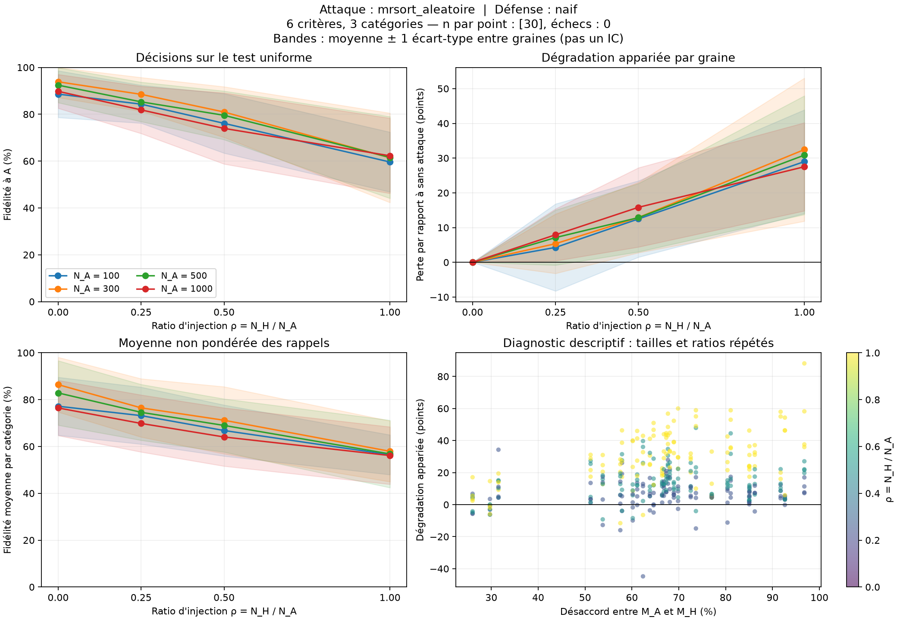

# Bilan de la campagne

480 parties ; 480 réussies ; 0 en erreur.

Les graines sont les répétitions indépendantes. Les tailles et ratios d'une même graine sont appariés.
Les dispersions sont des écarts-types entre graines ; elles ne sont pas des intervalles de confiance.

| Taille A | Ratio H/A | Attaque | Défense | n / échecs | Fidélité (%) | Écart-type (points) | Perte appariée (points) | Fidélité équilibrée (%) |
|---:|---:|---|---|---:|---:|---:|---:|---:|
| 100 | 0 | aucun | naif | 30 / 0 | 88.60 | 9.97 | 0.00 | 77.17 |
| 100 | 0.25 | mrsort_aleatoire | naif | 30 / 0 | 84.32 | 8.10 | 4.28 | 73.16 |
| 100 | 0.5 | mrsort_aleatoire | naif | 30 / 0 | 76.12 | 12.70 | 12.49 | 66.80 |
| 100 | 1 | mrsort_aleatoire | naif | 30 / 0 | 59.61 | 12.77 | 28.99 | 56.46 |
| 300 | 0 | aucun | naif | 30 / 0 | 93.86 | 6.71 | 0.00 | 86.39 |
| 300 | 0.25 | mrsort_aleatoire | naif | 30 / 0 | 88.50 | 7.21 | 5.36 | 76.48 |
| 300 | 0.5 | mrsort_aleatoire | naif | 30 / 0 | 80.96 | 10.80 | 12.90 | 71.19 |
| 300 | 1 | mrsort_aleatoire | naif | 30 / 0 | 61.42 | 19.10 | 32.45 | 57.93 |
| 500 | 0 | aucun | naif | 30 / 0 | 92.42 | 7.46 | 0.00 | 82.85 |
| 500 | 0.25 | mrsort_aleatoire | naif | 30 / 0 | 85.30 | 8.43 | 7.12 | 74.57 |
| 500 | 0.5 | mrsort_aleatoire | naif | 30 / 0 | 79.55 | 10.38 | 12.87 | 68.97 |
| 500 | 1 | mrsort_aleatoire | naif | 30 / 0 | 61.57 | 17.47 | 30.85 | 56.82 |
| 1000 | 0 | aucun | naif | 30 / 0 | 89.79 | 7.22 | 0.00 | 76.45 |
| 1000 | 0.25 | mrsort_aleatoire | naif | 30 / 0 | 81.87 | 10.08 | 7.92 | 69.83 |
| 1000 | 0.5 | mrsort_aleatoire | naif | 30 / 0 | 73.96 | 15.19 | 15.83 | 64.04 |
| 1000 | 1 | mrsort_aleatoire | naif | 30 / 0 | 62.28 | 16.06 | 27.51 | 56.12 |

## Figures

## Limites d'interprétation

- Sans défense (`naif`), un seul modèle est appris : aucune mesure de séparation des deux règles.
- À parts égales, le rôle A/H est indiscernable sous les lois symétriques du protocole.
- Le désaccord est un diagnostic du simulateur, caché à A, H et B. Il ne sélectionne pas les modèles.
- Le filtre des catégories rares est estimé sur 2 000 points distincts ; il conditionne la population étudiée.
- Les rappels par catégorie peuvent être imprécis pour les classes rares. La fidélité équilibrée est vide si une classe manque au test.
- L'apprentissage naïf utilise l'arrêt du jalon 2 (seuil de temps interne nominal de 4 s, ou arrêt anticipé). Ce seuil ne plafonne pas strictement la durée totale observée. Les données sont reproductibles ; les modèles appris peuvent varier avec la charge machine.
- Une augmentation de la perte avec le ratio n'est pas imposée. Une perte négative signifie une amélioration sur cette répétition.
- Le nuage désaccord/perte répète les mêmes modèles pour plusieurs tailles et ratios : il ne représente pas autant de répétitions indépendantes.
