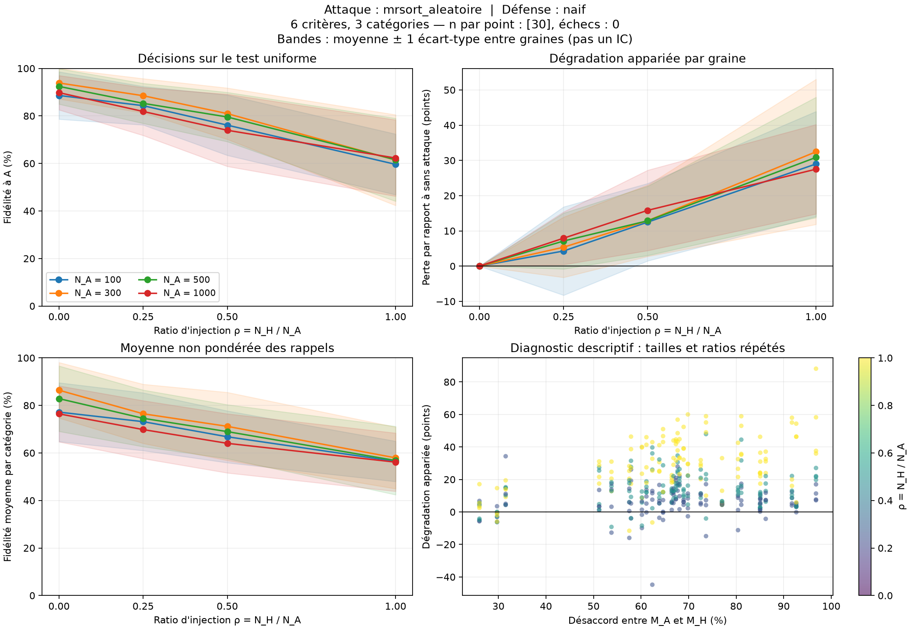

# Premier couple : MR-Sort cohérent / apprentissage sans défense

La campagne `uniforme-v1` comprend **480 apprentissages réussis, sans erreur**, sur 30 graines (0 à 29), 4 tailles de A et 4 ratios H/A. Chaque point des courbes agrège donc 30 répétitions. Les 30 jeux de test contiennent chacun 10 000 objets uniformes, communs aux conditions de la même graine.

Le [protocole détaillé](../../docs/protocole.md) fixe les hypothèses. H ne reçoit aucune donnée de A ; il tire un unique MR-Sort indépendant, de la même famille LINCS filtrée que celui de A. Toutes ses étiquettes sont cohérentes. B apprend un seul modèle sur tout le mélange.

## Résultats principaux

| Données A | Fidélité sans attaque (%) | Écart-type (points) | Fidélité à H/A = 1 (%) | Écart-type (points) | Perte appariée (points) |
|---:|---:|---:|---:|---:|---:|
| 100 | 88,60 | 9,97 | 59,61 | 12,77 | 28,99 |
| 300 | 93,86 | 6,71 | 61,42 | 19,10 | 32,45 |
| 500 | 92,42 | 7,46 | 61,57 | 17,47 | 30,85 |
| 1000 | 89,79 | 7,22 | 62,28 | 16,06 | 27,51 |

À ratio 1, H fournit autant de données que A, soit 50 % du mélange. La perte moyenne est comprise entre 27,51 et 32,45 points selon la taille. Le fait que chaque source soit cohérente ne suffit donc pas à protéger un apprentissage unique.

Pour 300 observations authentiques :

| Ratio H/A | Fraction malveillante du mélange | Fidélité moyenne (%) | Perte appariée (points) |
|---:|---:|---:|---:|
| 0 | 0.0 % | 93,86 | 0,00 |
| 0.25 | 20.0 % | 88,50 | 5,36 |
| 0.5 | 33.3 % | 80,96 | 12,90 |
| 1 | 50.0 % | 61,42 | 32,45 |

Les moyennes diminuent avec le ratio pour chacune des quatre tailles dans cette campagne. Cela ne constitue pas une monotonie imposée ou garantie pour chaque graine : certaines injections améliorent ponctuellement le résultat de l’heuristique. Les écarts-types sont larges, notamment à parts égales. Les bandes des graphiques représentent ± un écart-type entre graines, pas un intervalle de confiance.

## Quantité de données et budget de calcul

Sans attaque, la fidélité moyenne est de 93,86 % à 300 observations, contre 89,79 % à 1 000. Cette campagne ne permet donc pas d’affirmer que plus de données améliore systématiquement cet apprentissage. L’heuristique et son arrêt en temps réel font partie de la condition expérimentale ; une étude distincte du budget et de la convergence serait nécessaire pour isoler leurs effets.

L’arrêt interne de LINCS est réglé sur un seuil nominal de 4 secondes, mais le temps total observé n’est pas strictement plafonné : moyenne 4.45 s, minimum 0.09 s, maximum 9.28 s. La somme des durées mesurées des défenses est de 35.63 minutes, réparties entre trois processus. Les CSV conservent les durées individuelles. Les données sont reproductibles ; les modèles appris peuvent varier selon la charge machine.

## Catégories rares et désaccord des modèles

À 300 observations, la fidélité équilibrée passe de 86,39 % sans attaque à 57,93 % à parts égales. Cette mesure complète la fidélité globale en donnant le même poids à chaque catégorie.

Les trois catégories sont présentes dans tous les tests ; le plus petit effectif d’une catégorie est 61. Aucune fidélité équilibrée n’est manquante. Les rappels et effectifs par catégorie sont archivés, ce qui permet d’examiner leur précision limitée pour les classes rares.

Le désaccord entre M_A et M_H, estimé sur un diagnostic uniforme indépendant, vaut en moyenne 67.23 %, avec une étendue de 26.00 % à 96.78 %. Il n’a pas servi à sélectionner le hacker. Le nuage de points est descriptif : les tailles et ratios répètent les mêmes modèles au sein d’une graine.

## Ce que cette expérience ne démontre pas

- B n’apprend qu’un modèle : aucune conclusion sur la qualité d’une défense par segmentation, ni sur la récupération de deux règles.
- À parts égales, la symétrie des rôles A/H interdit leur identification certaine sans information supplémentaire ; une faible fidélité ne mesure pas uniquement une difficulté d’optimisation.
- Les poids et frontières ne sont pas identifiables uniquement à partir de décisions : la mesure principale porte sur les prédictions.
- Les résultats concernent 6 critères, 3 catégories, des performances uniformes et la famille de modèles LINCS filtrée ; ils ne couvrent pas toutes les distributions ou attaques.
- Les comparaisons de tailles combinent davantage de données authentiques, davantage de données H à ratio fixe et les limites de l’heuristique sous son arrêt actuel.

## Figures et preuves

- [Bilan et tableau des 16 configurations](bilan.md)
- [Résultats bruts](resultats.csv), [résultats appariés](resultats_apparies.csv), [synthèse](resume.csv)
- [Configuration et empreintes des sources](configuration.json)
- [Audit des 480 parties](audit.json) : modèles A/H/B rechargés, classes et mesures recalculées, emboîtement et appariement vérifiés.
- [Tests](tests_validation.txt) : 12 tests de contrat, de génération, de métriques et d’orchestration.
- Les sous-dossiers `instances/` conservent les modèles et données ; `sources/` conserve les sources utilisées au lancement.

La rédaction finale et le message de limite temporelle du bilan ont été précisés après lecture des durées observées, sans modifier ni relancer les apprentissages. Les sources du post-traitement sont archivées séparément dans `post_traitement/`.
