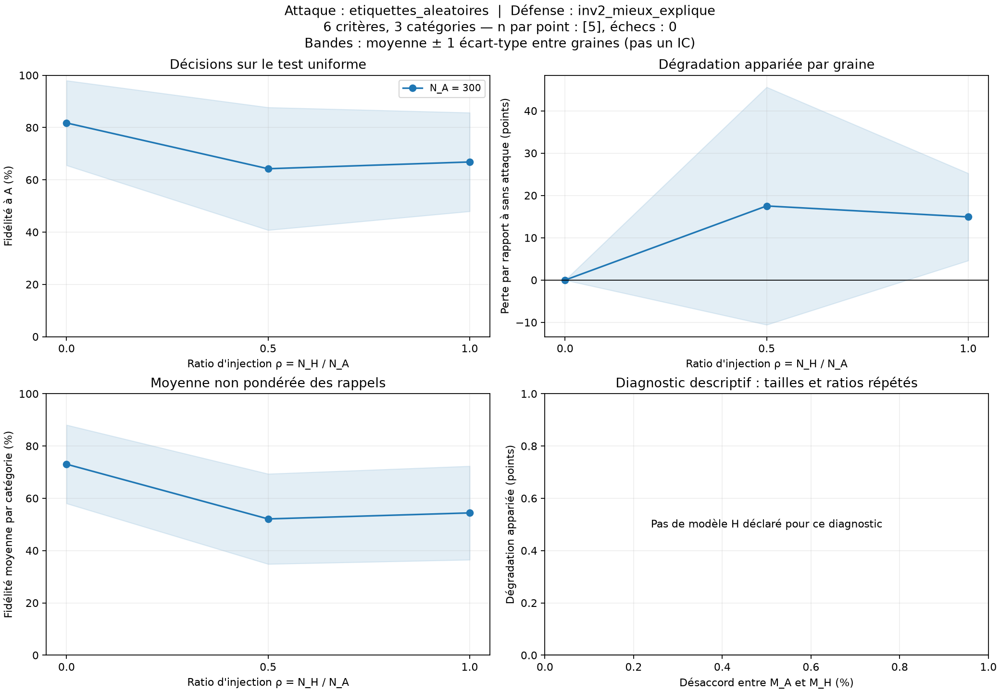
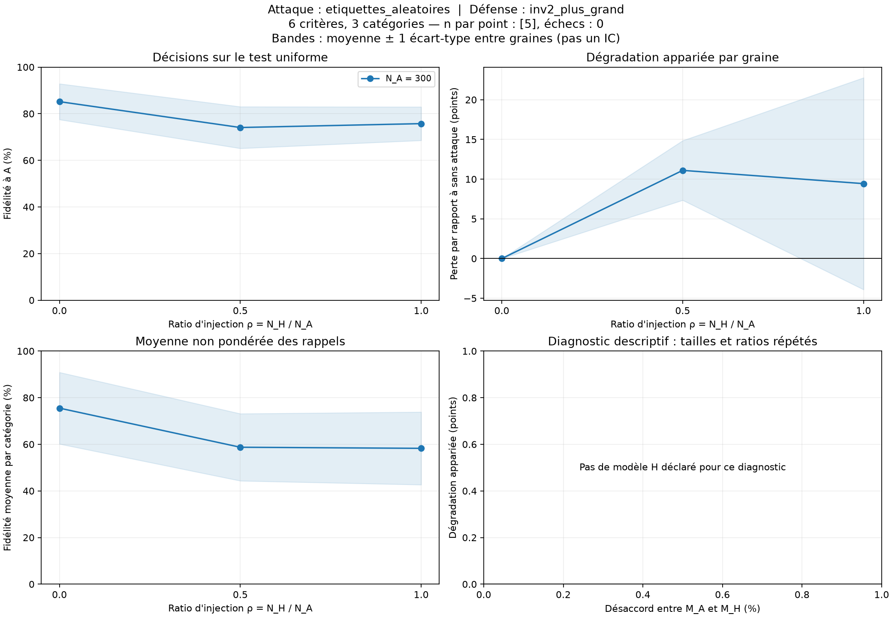
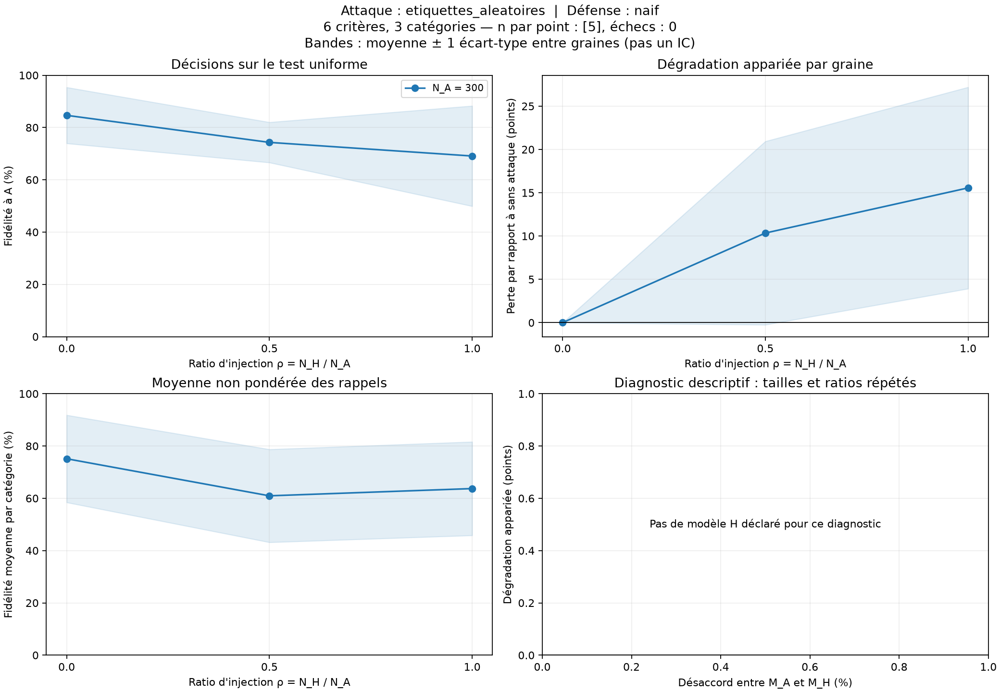
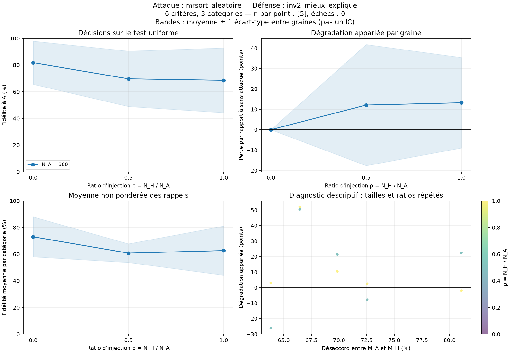
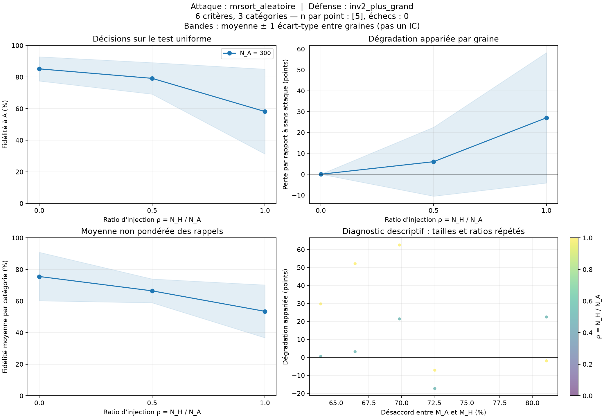
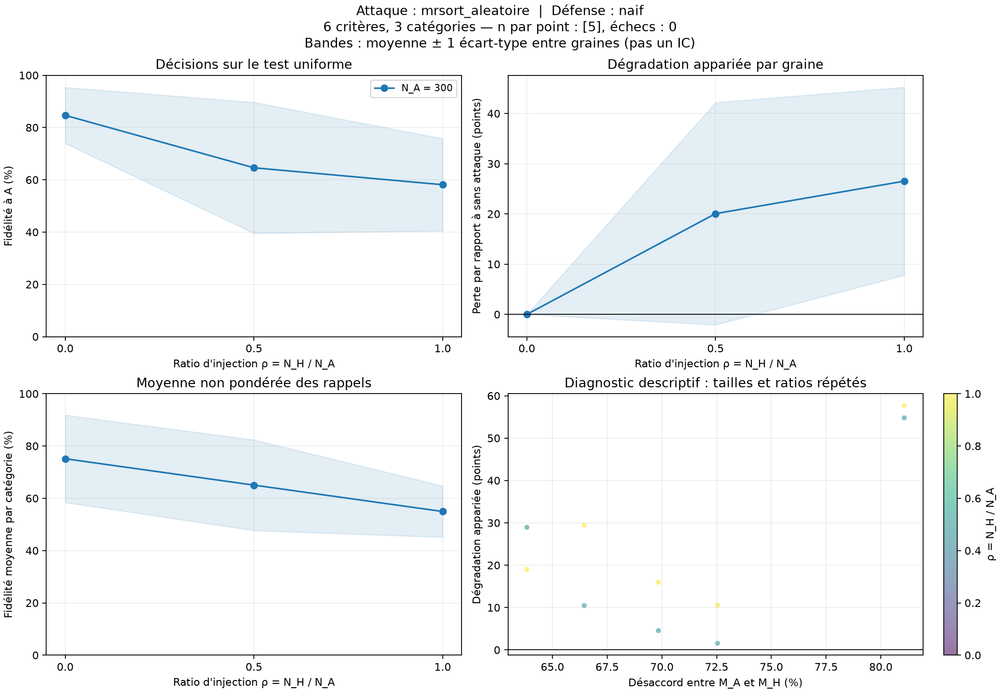
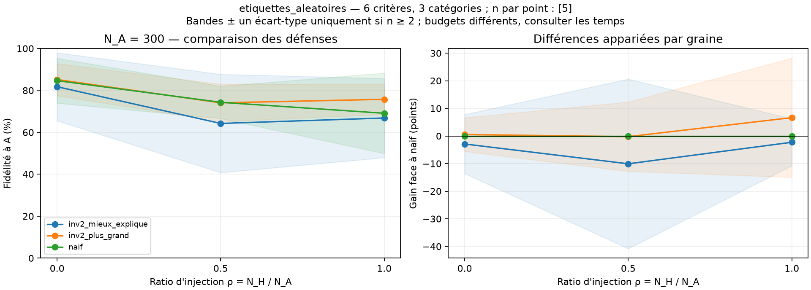
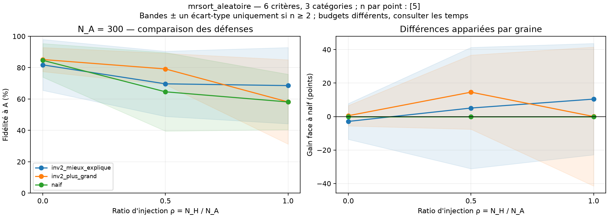

# Bilan de la campagne

75 parties ; 75 réussies ; 0 en erreur.

Les graines sont les répétitions indépendantes. Les tailles et ratios d'une même graine sont appariés.
Les dispersions sont des écarts-types entre graines ; elles ne sont pas des intervalles de confiance.

| Taille A | Ratio H/A | Attaque | Défense | n / échecs | Fidélité (%) | Écart-type (points) | Perte appariée (points) | Fidélité équilibrée (%) |
|---:|---:|---|---|---:|---:|---:|---:|---:|
| 300 | 0 | aucun | inv2_mieux_explique | 5 / 0 | 81.76 | 16.22 | 0.00 | 73.05 |
| 300 | 0 | aucun | inv2_plus_grand | 5 / 0 | 85.18 | 7.69 | 0.00 | 75.51 |
| 300 | 0 | aucun | naif | 5 / 0 | 84.66 | 10.72 | 0.00 | 75.13 |
| 300 | 0.5 | etiquettes_aleatoires | inv2_mieux_explique | 5 / 0 | 64.24 | 23.48 | 17.52 | 52.11 |
| 300 | 0.5 | etiquettes_aleatoires | inv2_plus_grand | 5 / 0 | 74.07 | 8.94 | 11.10 | 58.73 |
| 300 | 0.5 | etiquettes_aleatoires | naif | 5 / 0 | 74.32 | 7.71 | 10.35 | 60.95 |
| 300 | 0.5 | mrsort_aleatoire | inv2_mieux_explique | 5 / 0 | 69.68 | 20.79 | 12.07 | 60.80 |
| 300 | 0.5 | mrsort_aleatoire | inv2_plus_grand | 5 / 0 | 79.17 | 9.99 | 6.01 | 66.43 |
| 300 | 0.5 | mrsort_aleatoire | naif | 5 / 0 | 64.60 | 25.06 | 20.06 | 65.04 |
| 300 | 1 | etiquettes_aleatoires | inv2_mieux_explique | 5 / 0 | 66.83 | 18.88 | 14.93 | 54.41 |
| 300 | 1 | etiquettes_aleatoires | inv2_plus_grand | 5 / 0 | 75.74 | 7.20 | 9.43 | 58.26 |
| 300 | 1 | etiquettes_aleatoires | naif | 5 / 0 | 69.10 | 19.19 | 15.56 | 63.72 |
| 300 | 1 | mrsort_aleatoire | inv2_mieux_explique | 5 / 0 | 68.56 | 24.30 | 13.20 | 62.69 |
| 300 | 1 | mrsort_aleatoire | inv2_plus_grand | 5 / 0 | 58.15 | 26.89 | 27.03 | 53.45 |
| 300 | 1 | mrsort_aleatoire | naif | 5 / 0 | 58.13 | 17.66 | 26.53 | 54.95 |

## Figures

## Limites d'interprétation

- Sans défense (`naif`), un seul modèle est appris : aucune mesure de séparation des deux règles.
- À parts égales, le rôle A/H est indiscernable sous les lois symétriques du protocole.
- Le désaccord est un diagnostic du simulateur, caché à A, H et B. Il ne sélectionne pas les modèles.
- Le filtre des catégories rares est estimé sur 2 000 points distincts ; il conditionne la population étudiée.
- Les rappels par catégorie peuvent être imprécis pour les classes rares. La fidélité équilibrée est vide si une classe manque au test.
- L'apprentissage naïf utilise l'arrêt du jalon 2 (seuil de temps interne nominal de 4 s, ou arrêt anticipé). Ce seuil ne plafonne pas strictement la durée totale observée. Les données sont reproductibles ; les modèles appris peuvent varier avec la charge machine.
- Une augmentation de la perte avec le ratio n'est pas imposée. Une perte négative signifie une amélioration sur cette répétition.
- Le nuage désaccord/perte répète les mêmes modèles pour plusieurs tailles et ratios : il ne représente pas autant de répétitions indépendantes.

## Calcul, sélection et diagnostics

Le temps attribuable à une défense inclut toute sa préparation. Lorsque deux sélections partagent Inv-2, le temps de préparation est inclus dans chacune ; le calcul réellement exécuté n'est compté qu'une fois dans `temps_calcul_effectif`.

Le gain face à naif est calculé sur le même mélange et la même graine. Il ne prouve pas un avantage à budget égal : naif et Inv-2 gardent leurs arrêts propres. `naif_multi` est un contrôle de redémarrages, à budget demandé explicite.

Les fidélités oracle et reconstructions à permutation près utilisent les vérités cachées uniquement après la décision de B. Elles ne servent jamais à choisir son groupe. La perte de sélection sépare l'absence d'un bon candidat d'un mauvais choix parmi les candidats.

| Critères × catégories | Taille A | Ratio H/A | Attaque | Défense | Temps attribuable moyen (s) | Gain face à naif (points) | Perte de sélection (points) |
|---|---:|---:|---|---|---:|---:|---:|
| 6 × 3 | 300 | 0 | aucun | inv2_mieux_explique | 43.632 | -2.91 | 6.12 |
| 6 × 3 | 300 | 0 | aucun | inv2_plus_grand | 43.631 | 0.52 | 2.70 |
| 6 × 3 | 300 | 0 | aucun | naif | 4.650 | 0.00 | — |
| 6 × 3 | 300 | 0.5 | etiquettes_aleatoires | inv2_mieux_explique | 74.490 | -10.08 | 9.84 |
| 6 × 3 | 300 | 0.5 | etiquettes_aleatoires | inv2_plus_grand | 74.482 | -0.24 | 0.00 |
| 6 × 3 | 300 | 0.5 | etiquettes_aleatoires | naif | 4.590 | 0.00 | — |
| 6 × 3 | 300 | 0.5 | mrsort_aleatoire | inv2_mieux_explique | 76.177 | 5.08 | 9.49 |
| 6 × 3 | 300 | 0.5 | mrsort_aleatoire | inv2_plus_grand | 76.176 | 14.57 | 0.00 |
| 6 × 3 | 300 | 0.5 | mrsort_aleatoire | naif | 4.479 | 0.00 | — |
| 6 × 3 | 300 | 1 | etiquettes_aleatoires | inv2_mieux_explique | 78.427 | -2.28 | 8.92 |
| 6 × 3 | 300 | 1 | etiquettes_aleatoires | inv2_plus_grand | 78.413 | 6.64 | 0.00 |
| 6 × 3 | 300 | 1 | etiquettes_aleatoires | naif | 6.663 | 0.00 | — |
| 6 × 3 | 300 | 1 | mrsort_aleatoire | inv2_mieux_explique | 75.710 | 10.42 | 11.94 |
| 6 × 3 | 300 | 1 | mrsort_aleatoire | inv2_plus_grand | 75.710 | 0.02 | 22.35 |
| 6 × 3 | 300 | 1 | mrsort_aleatoire | naif | 5.204 | 0.00 | — |
