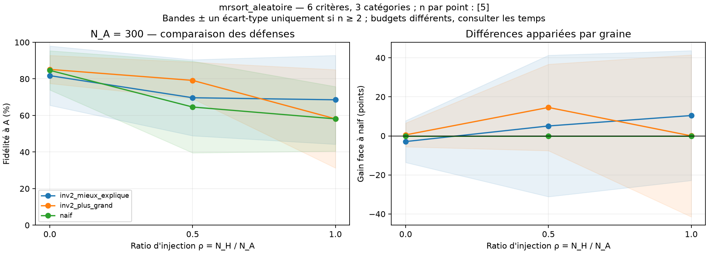
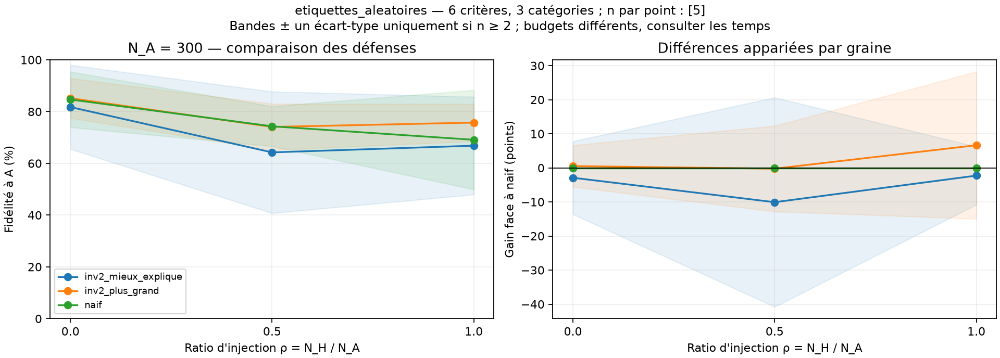

# Pilote des comparaisons : attaques aveugles et défenses

**75 décisions réussies, aucun échec**, sur cinq graines (0 à 4), 300 observations A, ratios H/A 0 / 0,5 / 1 et 10 000 objets de test uniformes par graine. Les deux attaques sont `mrsort_aleatoire` et `etiquettes_aleatoires`. Les défenses sont `naif`, `inv2_plus_grand`, `inv2_mieux_explique`.

Les données A, tests et diagnostics sont identiques aux mêmes graines de la campagne initiale ; les petits jeux A sont les préfixes des grands. Les modèles appris peuvent changer avec les durées réelles et la charge machine. Les moyennes de ce pilote à cinq graines ne doivent pas être confondues avec celles de la première campagne à trente graines.

Voir le [protocole des comparaisons](../../docs/comparaisons.md) et le [protocole des données](../../docs/protocole.md).

## Fidélité moyenne au modèle de A

| Attaque | Ratio H/A | Naïf (%) | Inv-2 : plus grand (%) | Inv-2 : mieux expliqué (%) |
|---|---:|---:|---:|---:|
| aucun | 0 | 84,66 | 85,18 | 81,76 |
| etiquettes_aleatoires | 0.5 | 74,32 | 74,07 | 64,24 |
| etiquettes_aleatoires | 1 | 69,10 | 75,74 | 66,83 |
| mrsort_aleatoire | 0.5 | 64,60 | 79,17 | 69,68 |
| mrsort_aleatoire | 1 | 58,13 | 58,15 | 68,56 |

Pour le hacker cohérent à H/A=0,5, la règle du plus grand groupe atteint 79,17 % contre 64,60 % pour le naïf, soit un gain apparié de 14,57 points. Le temps moyen attribuable est toutefois de 76,18 s contre 4,48 s : ce résultat ne démontre pas un avantage à budget égal.

À H/A=1, la règle du plus grand groupe obtient 58,15 % et celle du groupe le mieux expliqué 68,56 %, sur les mêmes candidats. La meilleure fidélité à A parmi ces candidats est 80,50 % en moyenne. Les pertes dues au choix du groupe sont donc respectivement de 22,35 et 11,94 points. Ce diagnostic utilise la vérité cachée après la décision, et ne constitue pas une défense réalisable.

À parts égales, les deux modèles cohérents et leurs observations sont statistiquement symétriques. Les inversions selon l’alignement diagnostique apparaissent sur 3/5 graines pour « plus grand » et 2/5 pour « mieux expliqué ». Cinq répétitions ne suffisent pas à conclure que cette seconde règle résout l’ambiguïté ou soit globalement supérieure.

Face aux étiquettes aléatoires à H/A=1, la règle du plus grand groupe atteint 75,74 %, contre 69,10 % pour le naïf et 66,83 % pour « mieux expliqué ». Il n’y a donc pas de sélection universellement gagnante dans ce petit pilote. Les dispersions et les gains appariés se trouvent dans le bilan et les figures.

## Partage du calcul et preuve

Le pilote contient 25 mélanges. Une préparation Inv-2 est réalisée pour chacun, puis les deux règles sélectionnent leur groupe sur exactement les mêmes modèles et partitions. Les 25 apprentissages naïfs portent sur les mêmes mélanges. Il y a donc 75 décisions, mais 50 appels aux pipelines d’apprentissage ; chaque Inv-2 réalise plusieurs appels lincs internes.

La somme des temps attribuables aux défenses est de 60.20 minutes, tandis que le calcul effectivement exécuté cumule 31.17 minutes, réparties entre trois processus. La préparation commune est incluse dans le coût autonome de chaque sélection, mais exécutée une seule fois. Ces sommes ne sont pas la durée murale de la campagne.

## Figures

Les bandes représentent ± un écart-type entre les cinq graines, pas un intervalle de confiance. Les gains sont appariés avant moyenne. Le dossier `figures/` contient aussi chaque couple séparément, en PNG et SVG.

## Artefacts et limites

- [Bilan complet](bilan.md), [synthèse CSV](resume.csv), [décisions appariées](resultats_apparies.csv).
- [Audit](audit.json) : 75 modèles retenus rechargés ; 25 partitions et paires de candidats partagées vérifiées ; métriques, sélection et temps recalculés.
- [Tests](tests_validation.txt) : 20 tests passants ; [journal](journal_execution.txt).
- Les modèles, partitions, injections et vérités de test sont conservés sous `instances/`. Les sources de lancement sont sous `sources/` ; le post-traitement final est conservé sous `post_traitement/`.
- Ce pilote explore les résultats. Une comparaison à budget de calcul égal et une validation sur davantage de graines restent nécessaires avant une conclusion de robustesse.
- Le filtrage et les attaques supplémentaires font l’objet d’un [essai fonctionnel distinct](../essai_nouvelles_strategies_v1/compte_rendu.md), sans agrégation de ses résultats avec ce pilote.
