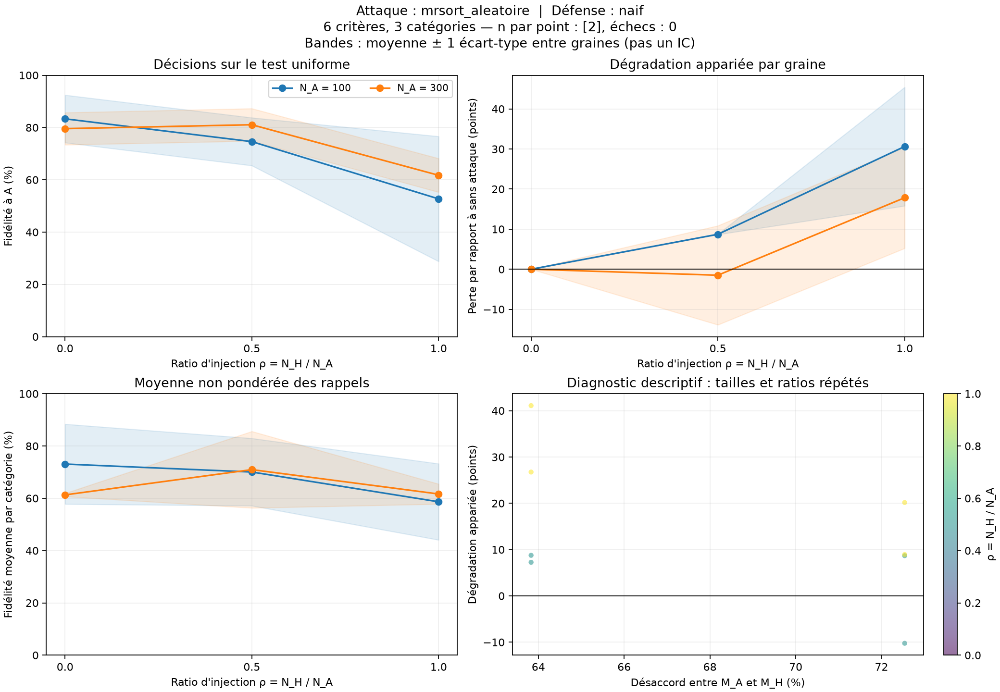

# Bilan de la campagne

12 parties ; 12 réussies ; 0 en erreur.

Les graines sont les répétitions indépendantes. Les tailles et ratios d'une même graine sont appariés.
Les dispersions sont des écarts-types entre graines ; elles ne sont pas des intervalles de confiance.

| Taille A | Ratio H/A | Attaque | Défense | n / échecs | Fidélité (%) | Écart-type (points) | Perte appariée (points) | Fidélité équilibrée (%) |
|---:|---:|---|---|---:|---:|---:|---:|---:|
| 100 | 0 | aucun | naif | 2 / 0 | 83.33 | 9.11 | 0.00 | 73.10 |
| 100 | 0.5 | mrsort_aleatoire | naif | 2 / 0 | 74.61 | 9.16 | 8.72 | 70.05 |
| 100 | 1 | mrsort_aleatoire | naif | 2 / 0 | 52.70 | 23.91 | 30.63 | 58.67 |
| 300 | 0 | aucun | naif | 2 / 0 | 79.57 | 6.15 | 0.00 | 61.31 |
| 300 | 0.5 | mrsort_aleatoire | naif | 2 / 0 | 81.07 | 6.22 | -1.50 | 70.97 |
| 300 | 1 | mrsort_aleatoire | naif | 2 / 0 | 61.73 | 6.45 | 17.84 | 61.65 |

## Figures

## Limites d'interprétation

- Sans défense (`naif`), un seul modèle est appris : aucune mesure de séparation des deux règles.
- À parts égales, le rôle A/H est indiscernable sous les lois symétriques du protocole.
- Le désaccord est un diagnostic du simulateur, caché à A, H et B. Il ne sélectionne pas les modèles.
- Le filtre des catégories rares est estimé sur 2 000 points distincts ; il conditionne la population étudiée.
- Les rappels par catégorie peuvent être imprécis pour les classes rares. La fidélité équilibrée est vide si une classe manque au test.
- L'apprentissage naïf utilise l'arrêt du jalon 2 (4 s maximum par appel, ou arrêt anticipé). Les données sont reproductibles ; les modèles appris peuvent varier avec la charge machine.
- Une augmentation de la perte avec le ratio n'est pas imposée. Une perte négative signifie une amélioration sur cette répétition.
- Le nuage désaccord/perte répète les mêmes modèles pour plusieurs tailles et ratios : il ne représente pas autant de répétitions indépendantes.
